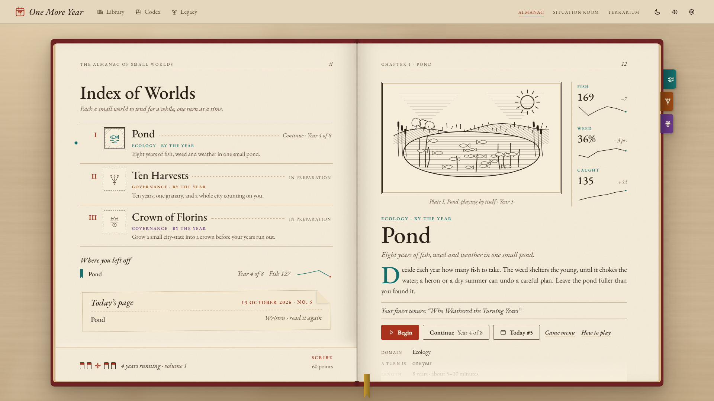
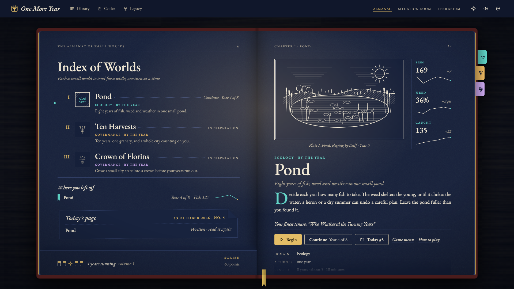
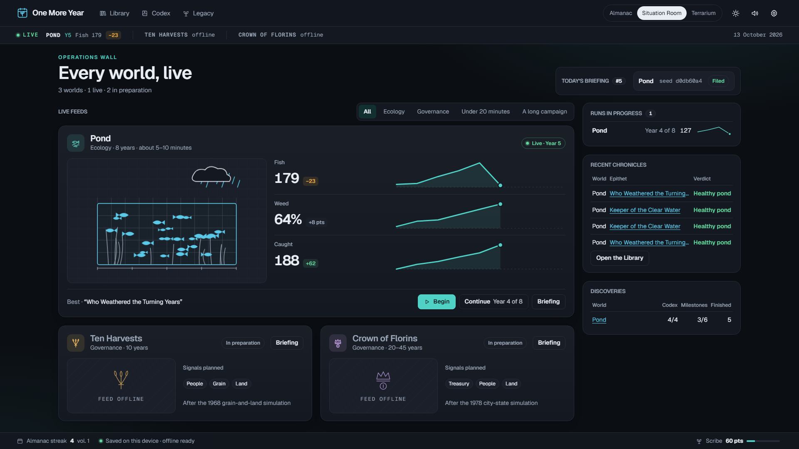
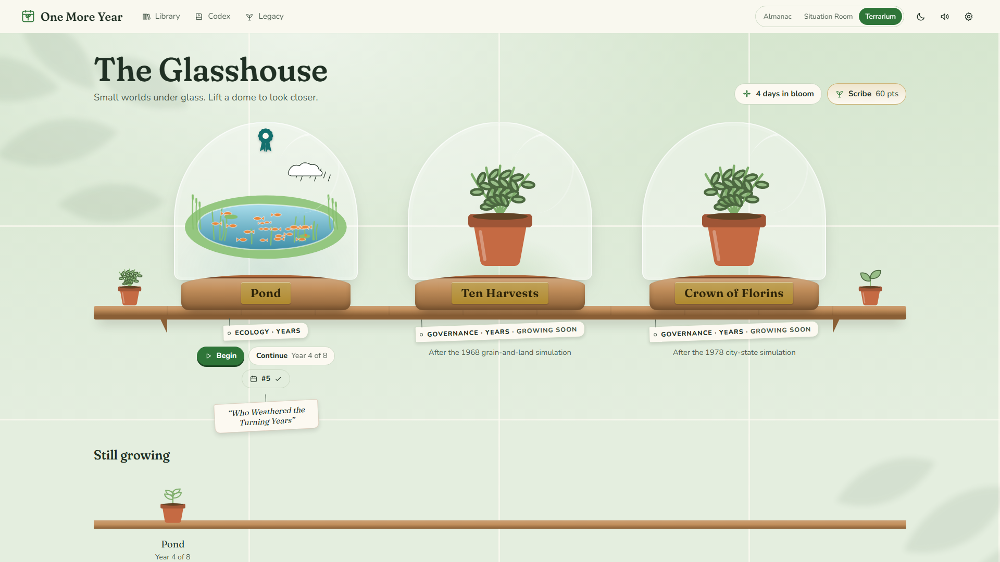

# One More Year

**Run a small world, one year at a time — and see whether you can stop at just one more.**



One More Year is an open-source collection of modern web simulations inspired by the turn-based
classics of the BASIC era. You read the year's report, make a handful of decisions, end the year
and see what the world does with them. Every world runs in your browser, offline, with nothing to
buy and nothing that nags you to come back.

## No arcade, only worlds

There are no reflex tests here, no high-score chases and no timer on any decision. Each simulation
is a small, honest model: the numbers on screen are the numbers the engine uses, forecasts show
their real uncertainty, and every run can be replayed on the same world with the same luck. These
are not emulators or ports; every model is rebuilt from scratch, in new code and new words.

## The worlds

<!-- sims:start -->

| World            | In one line                                                     | Domain     | A run                   | Players | After                              | Status         |
| ---------------- | --------------------------------------------------------------- | ---------- | ----------------------- | ------- | ---------------------------------- | -------------- |
| Ten Harvests     | Ten years, one granary, and a whole city counting on you.       | governance | 10 years · 10–20 min    | 1P      | the 1968 grain-and-land simulation | In preparation |
| Crown of Florins | Grow a small city-state into a crown before your years run out. | governance | 20–45 years · 30–90 min | 1–6P    | the 1978 city-state simulation     | In preparation |

<!-- sims:end -->

The list above is generated from the Hall's registry by `pnpm docs:sims`. More worlds will follow:
adding one is a single folder in `games/` with a manifest and a module (see
[ADR-0002](docs/adr/0002-contract.md)).

## Three ways to keep the almanac

| Almanac                                                         | Situation Room                                                                     | Terrarium                                                                 |
| --------------------------------------------------------------- | ---------------------------------------------------------------------------------- | ------------------------------------------------------------------------- |
|   |  |  |
| The book of years: each world a chapter with an engraved plate. | The world as data: every signal live on one calm wall.                             | Small worlds under glass on warm wooden shelves.                          |

Each theme has a designed light and dark appearance and follows your system setting if you like.

## Legacy

- **Chronicles.** Every finished run becomes a page of history with an epithet for your tenure, a
  timeline of good and hard years, key moments and charts, kept in your Library.
- **Same world, second chance.** Replay any world with the same seed and the same luck; your last
  run is drawn as a ghost line beside the new one.
- **The Codex.** Discover the phenomena each model produces, and after a few sightings learn how
  the model actually computes them, with real numbers.
- **Milestones and ranks.** Points for good stewardship, insight and curiosity raise your rank from
  Novice to Sage and unlock cosmetic covers, palettes and domes. Nothing is ever for sale.
- **A daily world and a gentle streak.** The same world for everyone each day, with a share string
  that holds no personal data, and an Almanac streak that forgives a missed day instead of breaking.

## Run it locally

Requires Node 22.12 or newer and pnpm 12.

```sh
pnpm install
pnpm dev        # the Hall on http://localhost:4479
```

```sh
pnpm build      # static site in hall/dist (BASE_PATH=/one-more-year/ for GitHub Pages)
pnpm preview    # the built site on http://localhost:5479
```

## Test

```sh
pnpm lint && pnpm typecheck
pnpm test       # unit tests: the kit and the Hall
pnpm check      # guardrails: zero raster, no network URLs in the build, fixtures never shipped
pnpm e2e        # build, then Playwright on ports 5479 (site) and 4479 (test harness)
```

The first time, install the browser with `pnpm exec playwright install chromium`. Screenshots in
`docs/media/` are regenerated with `pnpm shots`.

## Documentation

- [Architecture](docs/ARCHITECTURE.md) and the [decision records](docs/adr/)
- [Templates](docs/templates/) every simulation's docs follow
- [Progress](docs/PROGRESS.md)
- [Rules for AI coding agents](AGENTS.md)

## Credits and licence

The original programs, their authors and the sources used for every fact on the About page are
listed in [CREDITS.md](CREDITS.md). Nothing of their code or text is reused here.

Typefaces: EB Garamond, Geist, Geist Mono, Fraunces and Nunito, all under the SIL Open Font
License.

The code is released under the [MIT licence](LICENSE).
