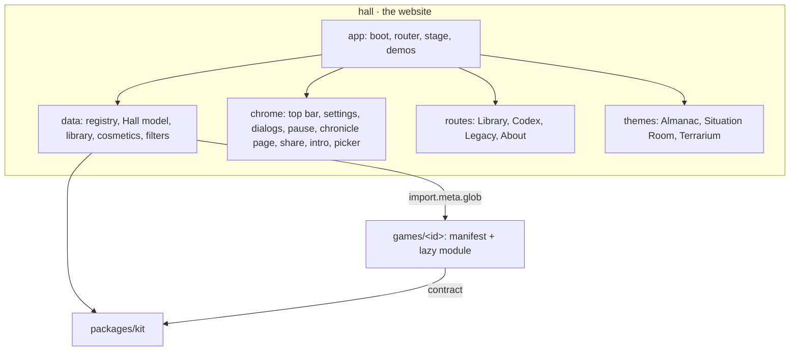
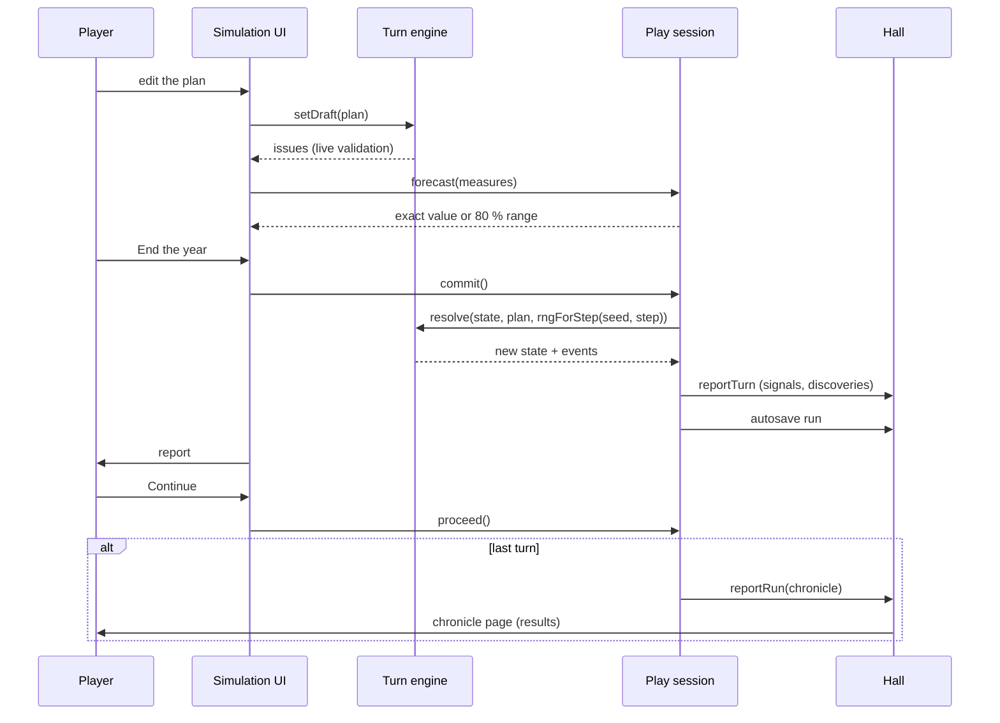
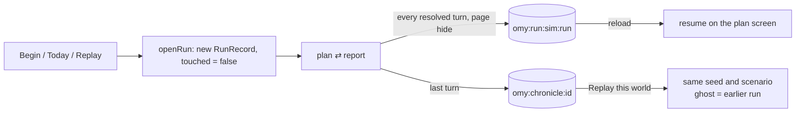
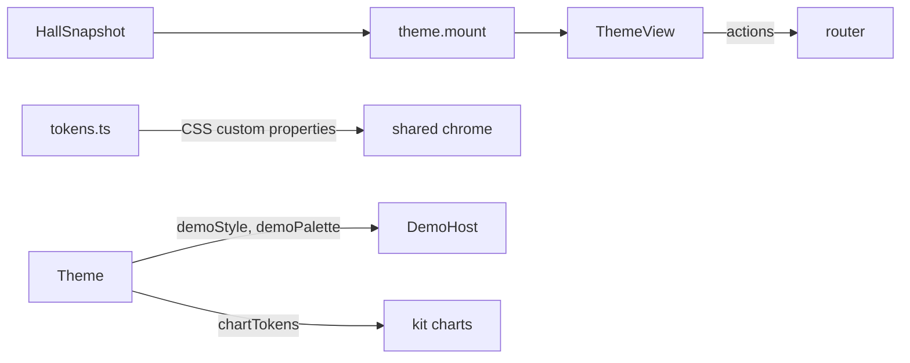

# Architecture

One More Year is a static website: the **Hall** (catalog, Library, Codex, Legacy, About and the
shared chrome) plus one lazy chunk per simulation. All shared behaviour lives in
**`packages/kit`**; every simulation is a folder in **`games/<id>/`** that plugs into the contract.
The decisions behind this page are in [`docs/adr/`](adr/).

## The kit

`packages/kit/src`, exported from `index.ts`. Every module has a header comment that says what it
is for and unit tests in `packages/kit/tests`.

| Module                                   | Role                                                                                                 |
| ---------------------------------------- | ---------------------------------------------------------------------------------------------------- |
| `rng`                                    | sfc32 seeded through splitmix32; `fork(label)` streams; Irwin–Hall `normal`                          |
| `turns`                                  | `TurnModel`, `createTurnEngine`, `rngForStep`, `replayPlans`, `seriesOf`                             |
| `forecast`                               | Exact or ranged previews of a plan on seeded sample streams                                          |
| `events`                                 | Typed events, severity, tone and headline of a turn, text by kind                                    |
| `session`                                | `startPlay`: engine + runs + autosave + reports + codex + forecasts + ghost + chronicle + milestones |
| `runs`                                   | Versioned run records, one key each; summaries readable without simulation code; autosave on hide    |
| `save`                                   | Storage that degrades to memory; versioned slots with migrations                                     |
| `chronicle`                              | Run history queries, epithet rules, key moments, `ChronicleEntry`, stable serialisation              |
| `daily`                                  | UTC day keys, daily number and seed, first-attempt results, the Almanac streak, share string         |
| `milestones`, `codex`, `legacy`, `stats` | Legacy books (ADR-0003)                                                                              |
| `seats`                                  | Hot-seat seats and the hand-over screen                                                              |
| `demo`                                   | `createModelDemo`: the real model played by a bot for the Hall's attract mode                        |
| `charts`                                 | SVG sparkline, line chart with ghost, stacked bars, text summaries and tables                        |
| `format`                                 | Tabular numbers, signed deltas with a true minus, percent, compact, ranges, turns, dates             |
| `audio`                                  | WebAudio cues and ambience beds, volumes, unlock on first gesture; no audio files                    |
| `settings`                               | Typed settings with system appearance and reduced motion, per-simulation namespace                   |
| `color`                                  | Contrast ratio and AA checks used by tests                                                           |
| `share`                                  | Copy text and download an SVG card                                                                   |
| `contract`                               | `SimManifest`, `SimModule`, `SimContext`, `SimInstance` (ADR-0002)                                   |

## The turn cycle

Engines are pure; the step stream is derived from the seed and the step number, so a run is fully
described by its setup and its plans (ADR-0006).

## Runs and replays

A run record holds the simulation's save version, the launch kind (new, daily, replay), the ghost
reference for replays and an engine snapshot (setup, state, history, opening signals, optional
kept draft). Runs left before the first turn with nothing kept are discarded on leave.

## The Hall data layer

`hall/src/data`:

- `coming-soon.ts`: the two planned worlds (Ten Harvests and Crown of Florins, both provisional
  titles), with emblems, accents and three signals each.
- `discovered.ts`: finds `games/*/manifest.ts` (eager) and `games/*/src/index.ts` (lazy).
- `registry.ts`: merges placeholders and discovered simulations by id and checks every manifest.
- `hall-model.ts`: builds the `HallSnapshot` from the registry and the services; themes only read
  it.
- `library.ts`, `cosmetics.ts`, `filters.ts`: chronicles, cosmetic choices, domain and length
  filters.

`hall/src/app/services.ts` creates one of each kit store over one storage, which is also what makes
"Forget my data" complete.

## Theme renderers

Each theme (`hall/src/themes/<theme>/`) is a TypeScript renderer and a stylesheet. Palettes for
all six variants are in `tokens.ts` and checked for AA in `hall/tests/theme-contrast.test.ts`. The
demo host starts a world's demo when its frame scrolls into view and pauses it off-screen.

## Routing and the stage

`hall/src/app/router.ts` parses hash routes into typed routes (ADR-0001). `hall-app.ts` renders the
route, keeps the global keys (Escape, R and H on results) and owns the intro and the picker.
`stage.ts` loads a simulation's module, builds its `SimContext`, mounts it, draws the pause button
and menu, handles leaving (with the keep-draft question) and shows the chronicle page when a run is
reported.

## Build, test and deploy

| Command                        | What it does                                                                                                                |
| ------------------------------ | --------------------------------------------------------------------------------------------------------------------------- |
| `pnpm dev`                     | Vite dev server on 4479 (`/harness.html` serves the Pond fixture for tests)                                                 |
| `pnpm build`                   | Builds `hall/dist` with `sw.js` precaching every file                                                                       |
| `pnpm preview`                 | Serves the build on 5479                                                                                                    |
| `pnpm test`                    | Vitest: kit and Hall unit tests                                                                                             |
| `pnpm e2e`                     | Build, then Playwright: site suite on 5479, harness suite on 4479                                                           |
| `pnpm lint` / `pnpm typecheck` | ESLint + Prettier, TypeScript across the workspace                                                                          |
| `pnpm check`                   | Guardrails: no raster outside `docs/media`, no network URLs in the build, no reference-folder paths, fixtures never shipped |
| `pnpm provenance <folder>`     | Fails if any 20+ character string from the originals appears in shipped source                                              |
| `pnpm shots`                   | Regenerates `docs/media/hero` and `docs/media/hall`                                                                         |
| `pnpm docs:sims`               | Rewrites the simulation list in `README.md` from the registry                                                               |

`.github/workflows/ci.yml` runs lint, typecheck, tests, checks, build and the end-to-end suites on
pull requests; `.github/workflows/pages.yml` builds for `/<repository>/` (`BASE_PATH`) and deploys to
GitHub Pages on pushes to `main` (the Pages source must be set to GitHub Actions).

## The Pond fixture

`hall/tests/fixtures/pond/` is a small but complete simulation used only by tests: eight years of
fish, weed and weather, with forecasts, events and codex entries, milestones, epithets, a daily
world, two-seat play and a demo bot. `hall/harness.html` boots the real Hall with Pond registered;
`pnpm check` asserts it never reaches the build. It is the reference integration for anyone
writing a simulation.
