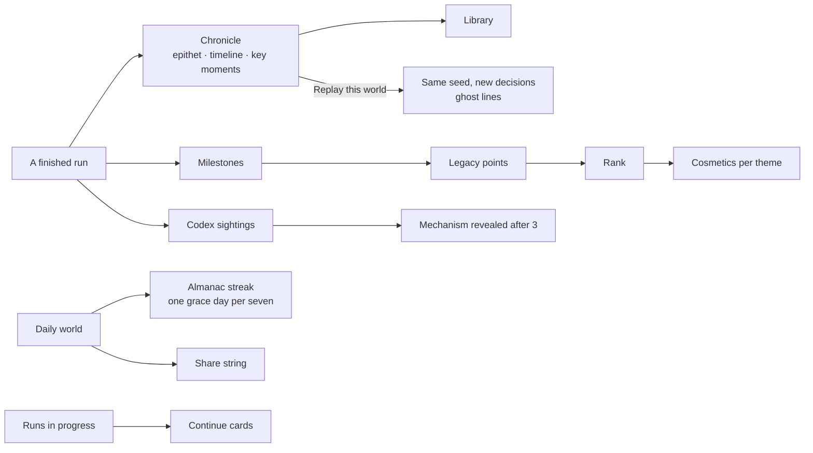

# ADR-0003: Legacy — how the collection is gamified

- Status: accepted
- Date: 2026-10-09

## Context

Turn-based simulations are slow, thoughtful and very replayable. The usual arcade rewards (high-score
tables, lives, timers) fit them badly, and the usual engagement tricks (loss-framed streaks,
notifications, loot) would be wrong for an all-ages collection. The owner left the design to the
architect with one instruction: reward understanding, stewardship and curiosity, not grind.

## Decision

Six pieces, all theme-agnostic data in `packages/kit` and `hall/src/data`; themes only present them.

1. **Chronicles.** Every finished run becomes a `ChronicleEntry` (`chronicle.ts`): a title line, an
   **epithet** chosen by the simulation's rules over the run's history (highest priority wins; the
   kit falls back to calm, mixed or stormy epithets), a timeline of turn tones (good, quiet, hard,
   disaster) with each turn's headline, two or three **key moments** (worst disaster survived,
   biggest swing, best turn; the hardest turn when nothing else qualifies), the signal series, the
   verdict, seed, scenario and date. Entries are stored one per key (`omy:chronicle:<id>`) with a
   stable, sorted-key serialisation, and shelved in the **Library** (`#/chronicles`), filterable by
   simulation, verdict and scenario and sortable by date or verdict.
2. **Replays and ghosts.** Engines are deterministic (ADR-0006), so "Replay this world" starts the
   same seed and scenario. The earlier run is drawn as a dashed ghost line on every chart, the
   report shows a quiet "last time" comparison, and the chronicle's rubric notes it was a second
   chance.
3. **Milestones, points, ranks and cosmetics.** Each simulation defines about 12–20 milestones in
   three kinds (stewardship, insight, curiosity) worth 10–40 points each; secret ones show as "a
   secret milestone" until unlocked. Points are stored with each unlock, so a later rebalance never
   takes points away. Total points give a rank, and each rank unlocks one **cosmetic per theme**,
   chosen on the Legacy page. Cosmetics never touch any simulation.
4. **Scenarios and the daily world.** Scenarios are curated starting worlds from the manifest. The
   daily world per simulation comes from the UTC date (`dailySeed(simId, day)`), is numbered from
   launch day (`LAUNCH_DAY = '2026-10-09'` is #1), is only offered for playable simulations, and
   keeps only the **first attempt** of the day for the share string; replays are always allowed.
5. **The Codex.** Each simulation defines phenomena with a summary, a tendency, a hint for the
   silhouette, code-drawn art and the honest mechanism. The first sighting is a discovery ("New in
   your Codex" in the report); after three sightings (configurable) the Codex shows how the model
   actually computes it.
6. **The Almanac streak.** Beginning any daily world on a UTC day extends it ("12 years running").
   A missed day is forgiven as a pressed flower if no other day was forgiven in the previous six. A
   longer gap closes the volume quietly and the next daily begins a new one; nothing announces the
   loss. **Runs in progress** are always offered as Continue, newest first, with the turn ("Year 6
   of 10"), the lead signal and a sparkline.

### Ranks

| Rank            | Points | Motto                                |
| --------------- | ------ | ------------------------------------ |
| Novice          | 0      | You have opened the almanac.         |
| Scribe          | 40     | You keep a careful record.           |
| Steward         | 120    | Worlds prosper in your care.         |
| Chronicler      | 250    | Your years are worth reading.        |
| Keeper of Years | 420    | You know how these worlds turn.      |
| Sage            | 650    | Little in these pages surprises you. |

The suggested ladder (Novice · Clerk · Steward · Governor · Sovereign · Sage) was refined: "Clerk"
became **Scribe** and "Governor" and "Sovereign" became **Chronicler** and **Keeper of Years**,
because the collection is about keeping a record of worlds, not about ruling people, and the old
words fit only the governance simulations.

### Cosmetics (one per rank per theme)

| Rank            | Almanac (cover and ribbon) | Situation Room (palette) | Terrarium (dome trim and plant) |
| --------------- | -------------------------- | ------------------------ | ------------------------------- |
| Novice          | Linen and red silk         | Standard issue           | Plain glass and a seedling      |
| Scribe          | Oxblood cloth              | Harbour                  | Copper and fern                 |
| Steward         | Forest buckram             | Meridian                 | Brass and moss                  |
| Chronicler      | Navy morocco               | Ember                    | Verdigris and cactus            |
| Keeper of Years | Tan calf                   | Aurora                   | Silver and bonsai               |
| Sage            | Midnight vellum            | Obsidian gold            | Gold and orchard                |

Every cosmetic colour is checked for AA contrast in light and dark by the Hall's unit tests.

## Alternatives considered

- **A broken-chain streak.** Rejected: it punishes a missed day, which is exactly the pressure this
  collection refuses.
- **Leaderboards.** Rejected: there is no server, and comparing verdicts is what the daily share
  string is for, between people who choose to share.
- **Unlockable scenarios or difficulty.** Rejected: rewards must never change what a player can play.

## Consequences

- Simulations write their own epithet rules, milestones, codex entries and share glyphs; the kit
  supplies the engines (rules, unlocks, sightings, format limits).
- "Forget my data" erases all of it: runs, chronicles, codex, milestones and cosmetics, daily
  results and the streak, statistics and settings.
