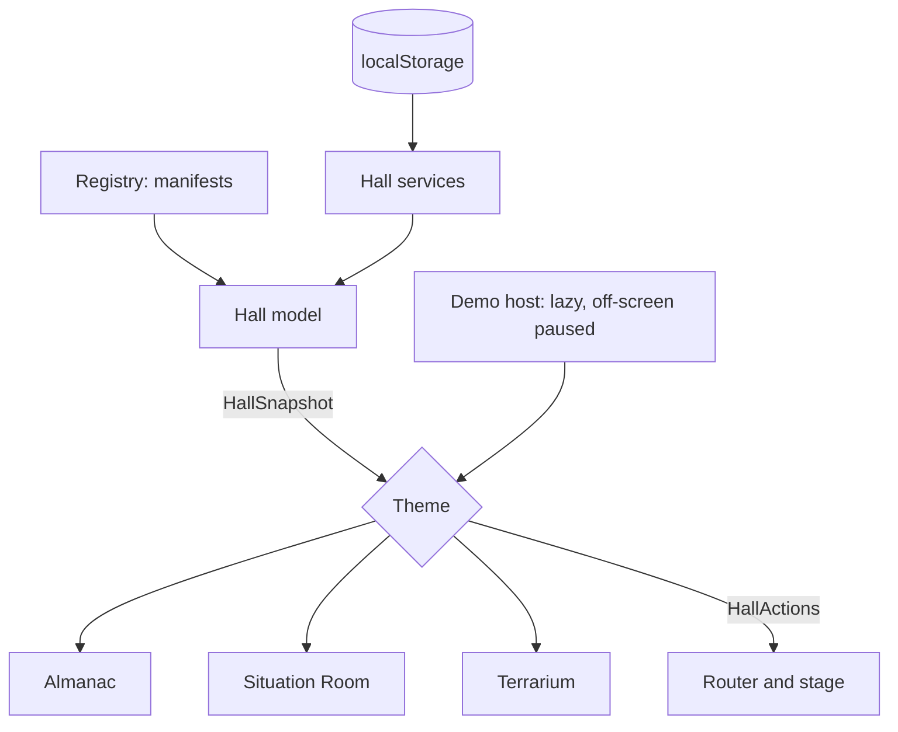

# ADR-0004: Three Hall themes in light and dark

- Status: accepted
- Date: 2026-10-09

## Context

The Hall is the first thing a visitor sees and the place every run starts and ends. Different
players read worlds differently: some want a book, some a dashboard, some a toy. The collection's
promise is that numbers are beautiful, and each look has to make that true. Six variants (three
themes × light and dark) must each be designed, not recoloured, and adding a simulation must never
mean touching a theme.

## Decision

A theme is a **renderer over a shared data layer**. `hall/src/data/hall-model.ts` builds one
`HallSnapshot` (registry entries with runs, chronicles, codex and milestone counts, today's daily
worlds, streak, rank, stats); themes receive the snapshot and a set of `HallActions` (focus, begin,
continue, play daily, game menu, how to play, open chronicle, Library, Codex, Legacy, About) and
never read storage or the registry themselves.

The `Theme` interface (`hall/src/themes/theme.ts`) has an id, a **demo style** (`engraving`,
`instrument` or `diorama`) and a **demo palette** per appearance, **chart tokens** per appearance,
and `mount(container, snapshot, context)`, which returns a view with `update`, `focus`,
`setAppearance` and `dispose`.

Colour tokens for every theme × appearance live in `hall/src/themes/tokens.ts` and are injected as
CSS custom properties under `[data-theme][data-appearance]`. The shared chrome (top bar, settings,
dialogs, pause menu, chronicle page, share card, Library, Codex, Legacy, About, loading) is styled
from those tokens plus small per-theme rules, so each theme skins it without forking it. Themes
never restyle the inside of a simulation; simulations style themselves under their own class.

| Theme                 | Idea                                                                                                                                                                                                 | Light                                                                         | Dark                                                                                         |
| --------------------- | ---------------------------------------------------------------------------------------------------------------------------------------------------------------------------------------------------- | ----------------------------------------------------------------------------- | -------------------------------------------------------------------------------------------- |
| **Almanac** (default) | An open book of years on a desk: the index of worlds on the left page, the focused world as an engraved plate on the right, ribbon tabs, today's leaf, the streak as year-marks with pressed flowers | Morning study: vellum, sepia ink, vermilion rubrics, gilt edges, window light | Lamplight: ink-blue paper, ivory type, gold-leaf rubrics, a lamp pool on the book            |
| **Situation Room**    | An operations wall: each world a live feed tile with its demo beside crisp sparklines and large tabular figures, a year ticker, today's briefing, a status bar                                       | Briefing: white and pale grey, graphite type, signal blue, amber warnings     | Night shift: charcoal glass, cool cyan lines, amber warnings, a single magenta for disasters |
| **Terrarium**         | Small worlds under glass on oak shelves: brass labels, domain tags, a rosette on daily domes, chronicles as pressed-paper labels                                                                     | Greenhouse noon: pale green glass, terracotta, leaf shadows                   | Firefly night: deep teal, moonlit glass, worlds glowing from inside, slow fireflies          |

Coming-soon worlds are drawn on purpose in every theme: a pencilled plate "in preparation", an
offline feed with its planned signals, a pot still growing. Layouts are verified with 2 and with 20
worlds using generated fixture manifests that never ship.

All motion is slow and physical (page turns, ink, glass, growth). Reduced motion (the setting or
`prefers-reduced-motion`) turns it into cross-fades or stills.

## Alternatives considered

- **One layout with three palettes.** Rejected: that is a recolour, and it would make every theme
  look like a dashboard or every theme look like a book.
- **Themes reading storage directly.** Rejected: three copies of the same queries drift apart; one
  snapshot keeps every theme telling the same truth.

## Consequences

- Adding a simulation touches no theme. Adding a theme means one renderer, one token set per
  appearance, a demo style the kit's demos understand, and contrast tests for its palettes.
- Each simulation's demo must draw in all three styles from the palette it is given.
- AA contrast for every token pair and every simulation accent is asserted in unit tests.
