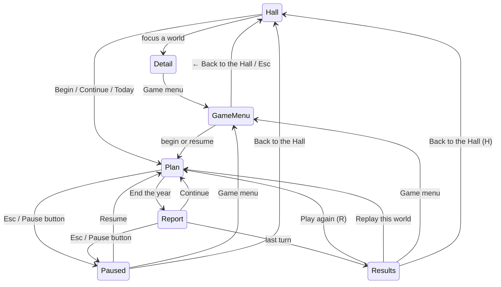

# ADR-0005: Navigation standard and shared chrome

- Status: accepted
- Date: 2026-10-09

## Context

Players move between simulations written by different sessions. If each names its exits
differently or orders its pause menu its own way, the collection feels like a pile of websites. The
navigation has to be built into the Hall's chrome once, so every simulation inherits it by
following the contract (ADR-0002) rather than by copying a pattern.

## Decision

Two destinations with fixed names everywhere: **Game menu** (the simulation's own title screen)
and **Back to the Hall**.

- **Game menu**: "← Back to the Hall" top-left; Escape there returns to the Hall.
- **During play**: a visible Pause button with an "Esc" hint, drawn by the Hall above the simulation.
- **Pause menu order**: Resume · the simulation's items (`setPauseItems`) · How to play · Settings
  · Game menu · Back to the Hall.
- **Results** are the chronicle page (`#/chronicles/<id>?results`): Play again (R) · Replay this
  world · Game menu · Back to the Hall (H). A simulation with its own end screen reports with
  `presentation: 'game'` and hands over to the chronicle page afterwards.
- **Leaving mid-run** never asks when the run is saved, which it always is after a resolved turn.
  It asks only when the plan has unsaved edits (`leaveCheck()`), and then offers "Keep it as a
  draft", "Leave without it" or "Stay". A run left before its first turn with nothing kept is
  discarded, so a quick look never clutters Continue.
- **Browser Back works**: every place is a hash route (ADR-0001); the play route carries the run
  id, so a reload resumes the same run on its plan screen.
- **First visit to any simulation**: a one-time hint, "Esc — pause and menu · your world saves
  itself every turn".
- **Keys that work everywhere**: Escape closes the top dialog, then pauses, then leaves a game
  menu; R and H on results. No key is bound while the player is typing in a field.
- **Settings panel**: appearance (Light, Dark, System), theme, volumes, reduced motion, text size,
  advisor hints, forecasts shown or hidden, "Show the intro again", "Choose a theme again",
  "Forget my data" with the full list of what is erased, plus the simulation's own options when
  opened from a simulation.
- **Share card**: a themed SVG with the emblem, the epithet, the timeline strip, the final signals
  and the daily number if any; never a name or any personal detail.

## Alternatives considered

- **A confirm on every exit.** Rejected: autosave makes it noise, and noise teaches players to
  click through the one confirm that matters (an edited plan).
- **Simulations drawing their own pause menus.** Rejected: the order would drift between
  simulations, and the Hall could not guarantee Settings or Back to the Hall.

## Consequences

- Simulations supply pause items and report their view; they never draw exits.
- The harness end-to-end suite checks the pause order, the results row, the keys and the leave
  flow against the Pond fixture, so a regression fails before any real simulation notices.
