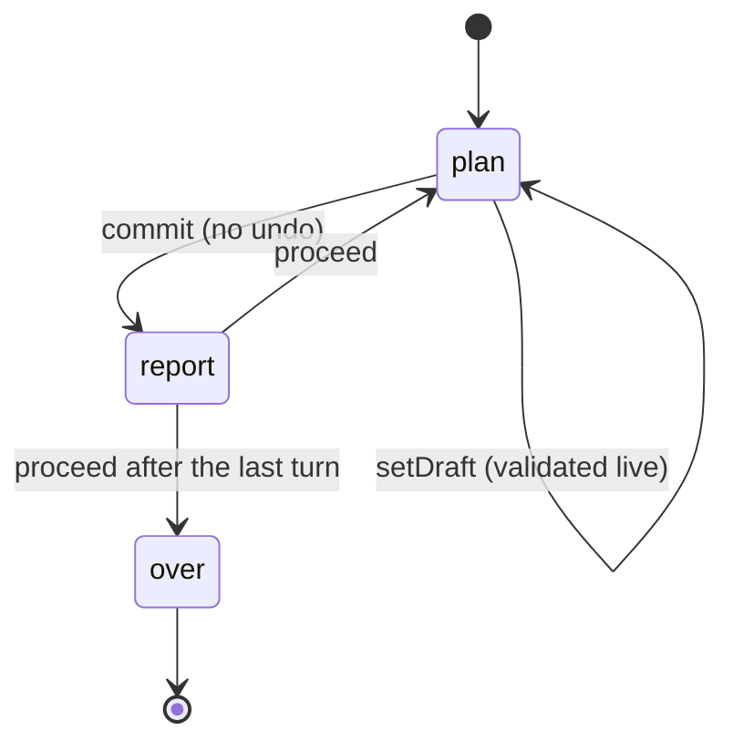

# ADR-0006: Turn engine, determinism and honest forecasts

- Status: accepted
- Date: 2026-10-09

## Context

The originals were a loop: print a report, read a few numbers, compute the year, repeat. That loop
is the shape every simulation here shares. Three Legacy features depend on it being exact:
replaying a world (same luck, different decisions), the daily world (the same for everyone that
day) and ghost lines (the earlier run drawn beside the new one). Forecasts must also never lie or
peek at the dice the real turn will use.

## Decision

### The cycle

A simulation provides a pure `TurnModel<State, Plan>`: `init(setup)`, `draft(state)`,
`validate(state, plan)`, `resolve(state, plan, rng)`, `signals(state, seat)`, `position(state)`
and `outcome(state)`. Pure means no clock, no DOM, no `Math.random`, no mutation of arguments, and
State and Plan survive JSON.

`createTurnEngine(model, start)` keeps the phase, the draft, the history of
`{step, turn, seat, plan, events, signals, tone}` and the opening signals of each seat, and
produces snapshots for saving. `startPlay(ctx, rules, launch)` wraps it with everything else
(ADR-0002).

### Determinism

- **RNG**: sfc32 seeded through splitmix32 (`rng.ts`). Integers and floats only; `normal()` is the
  Irwin–Hall sum of twelve uniforms, so no `Math.log` or `Math.sin` whose last bits could differ
  between browsers.
- **Streams**: `rng.fork(label)` is a pure function of the parent stream's key and the label, never
  of how much the parent has drawn. Adding a draw to the weather stream cannot reshuffle the events
  stream.
- **Per step**: the stream for step _n_ is `rngForStep(seed, n) = createRng(seed).fork('step:' + n)`.
  It is derived, never carried over, so a replay cannot drift even if a simulation draws a
  different number of times on a different plan.
- **Replay**: `replayPlans(model, setup, plans)` rebuilds a run from its seed and plans. Every
  simulation must have a test that a full run replayed this way reproduces every signal exactly.

### Forecasts

`forecast(model, state, plan, measure, options)` runs the pure step on copies:

- If the probe step draws no random numbers, the result is **exact**.
- Otherwise it samples 200 worlds on streams forked from `forecast` and reports the range covering
  80 % of them with the median, labelled as a range.
- The sample streams are seeded with `forecastSeed(worldSeed, step)`, never with the step's real
  stream, so the forecast cannot leak the actual outcome, and it does not jitter while the player
  edits the plan.

A kit test checks that ranges contain the realised value at about the stated rate on a seeded
model. Players can hide forecasts in settings.

### Events

Reports and chronicles are built from typed events (`event(kind, severity, numbers, extras)`):
severity good, neutral, warning or disaster, the numbers involved, an optional codex id and a
weight. The simulation supplies one text function per event kind. A turn's tone is derived from
its events.

## Alternatives considered

- **Carrying one RNG through the whole run.** Rejected: any change in how many numbers one turn
  draws would shift every later turn and break replays across versions.
- **Monte Carlo forecasts on `Math.random`.** Rejected: the numbers would jump on every keystroke
  and could not be tested.
- **Undo after commit.** Rejected by design: committing a year is the decision; the forecast and
  the live validation are there before it.

## Consequences

- Engines are trivially testable and their balance can be simulated with bots in Vitest.
- A saved run is its setup, state, history, opening signals and an optional kept draft; replays
  need only the seed, the scenario and the plans.
- Changing an engine's rules changes old replays; the save version and migrations (ADR-0007) say
  how a simulation handles that.
