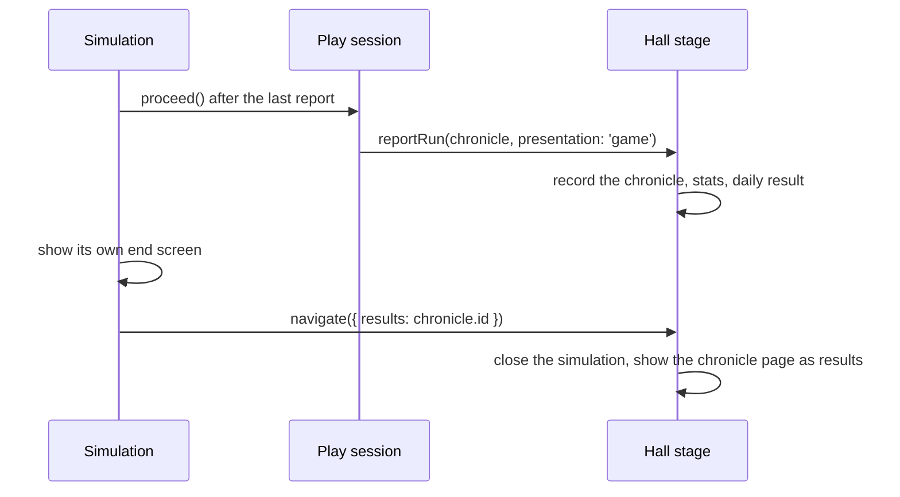

# ADR-0008: Handing a run over to its results after the simulation's own end screen

- Status: accepted
- Date: 2026-10-10

## Context

ADR-0002 and ADR-0005 let a simulation show its own end screen before the Hall's chronicle page:
it reports the finished run with `presentation: 'game'`, and "hands over to the chronicle page
afterwards". The contract had no way to do that hand-over. `navigate` knew only the game menu, the
Hall and a new launch, so a simulation with an end screen (Ten Harvests carves a stele) could not
reach the results row (Play again · Replay this world · Game menu · Back to the Hall) without
reporting the run a second time, which would count the run twice in the statistics.

## Decision

`Destination` gains one form, `{ results: chronicleId }`. A simulation calls
`ctx.navigate({ results: chronicle.id })` when the player leaves its end screen. The stage closes
the simulation and shows that chronicle as results, exactly as it does for `presentation: 'hall'`.

## Consequences

- The run is recorded once, when it ends; the hand-over only changes the view.
- Simulations that report with `presentation: 'hall'` are unaffected.
- The change is one union member in `packages/kit/src/contract.ts` and one branch in
  `hall/src/app/stage.ts`. Ten Harvests' end-to-end suite covers it through the real Hall (the stele,
  then the chronicle page with its results row).
