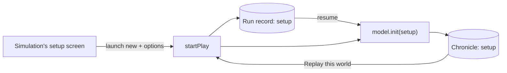

# ADR-0009: Setup choices travel with the world

- Status: accepted
- Date: 2026-10-13

## Context

`WorldSetup` held a seed, a scenario and a seat count. That was enough for every simulation so far:
the world followed from those three. Crown of Florins asks more of the player before the first year.
Each of up to six seats is a human or an AI rival with a personality, a ruler's name and form of
address, a town and a coat of arms, and the court chooses a difficulty and a fate (one reign or a
dynasty). None of that fits in a scenario id, and all of it changes the world.

If the choices lived only in the simulation's own storage, three things would break. A resumed run
could not rebuild its world from the setup alone. "Replay this world" would replay the seed with a
different court. And the chronicle would not say who played.

## Decision

`WorldSetup` gains an optional `options` record, and the `new` launch gains the same field. The
play session copies `launch.options` into the setup of a new run. From there the existing paths
carry it unchanged: the run record saves the setup, a resume reads it back, the chronicle stores the
setup, and a replay starts from the chronicle's setup.

Options must survive JSON, like state and plans: strings, numbers, booleans, null, arrays and plain
objects (`OptionValue`). The kit never reads them. The model's `init(setup)` interprets them and
must give the same world for the same seed, scenario, seats and options.

## Consequences

- Simulations without setup choices are unaffected: a launch without options gives a setup without
  the field, exactly as before.
- A launch from the Hall ("Begin" on a card, "Play again" on the results row) carries no options.
  A simulation that needs them may fill them in before starting the run, for instance from the
  last court the player set up, which it keeps in its own settings.
- The daily world still takes its setup from the day's seed alone, so every player meets the same
  court on the same day.
- The kit tests cover options through a resume, the chronicle and a replay
  (`packages/kit/tests/session.test.ts`).
