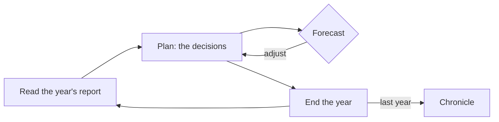

# <Simulation title>

<!--
The brochure. Written for someone deciding whether to press Begin. Short paragraphs, plain words,
our own words throughout. Copy this file to games/<id>/docs/ABOUT.md and replace every <...>.
Facts about the original come only from NOTES.md or the sources listed in CREDITS.md.
-->

> <The tagline from the manifest, exactly as the Hall shows it.>

## The original

<Two or three sentences: what the original program was (by its generic description, e.g. "the 1968
grain-and-land simulation"), who wrote it, when and where it was published. The original title may
appear here and in CREDITS only.>

## The hook

<One paragraph on the single tension that made the original worth a second run, and that this
simulation keeps. What is the player always short of? What do they gamble on, year after year?>

## What it is like now

<What the reborn simulation looks, sounds and feels like. The signature moment of a turn. How the
report reads, how the forecast helps, what the chronicle says about you at the end. Light and dark.
Why it is worth twenty minutes today.>

<!-- Replace with a diagram that says something about this world: what the player trades off each
turn, how the model's numbers feed each other, or how a run escalates. At least one Mermaid diagram. -->

## At a glance

|             |                                                           |
| ----------- | --------------------------------------------------------- |
| Players     | <1P or 1–6P hot-seat>                                     |
| A turn is   | <one year / season / …>                                   |
| A run lasts | <typical turns> · about <minutes> minutes                 |
| Scenarios   | <count and one-line flavour>                              |
| Daily world | <yes / no>                                                |
| Rendering   | <SVG / Canvas 2D / WebGL / three.js, see ARCHITECTURE.md> |

## Why play it today

<Three bullets at most: what makes this version worth the time of someone who never saw the
original, and of someone who did.>
