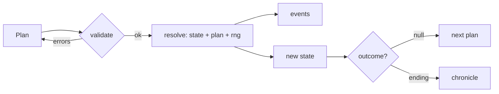

# <Simulation title> — architecture

<!--
For programmers. Someone who has never seen this folder should be able to change a formula, add a
scenario or recolour a sprite after reading it. Mermaid diagrams only. Copy to
games/<id>/docs/ARCHITECTURE.md.
-->

## Module map

```mermaid
flowchart TD
  manifest[manifest.ts] --> hall[Hall registry]
  index[src/index.ts · SimModule] --> engine[src/engine · TurnModel]
  index --> render[src/render]
  index --> ui[src/ui · plan, report, menu]
  engine --> kit[@one-more-year/kit]
  render --> kit
  ui --> kit
```

| Folder / file  | What it owns                                                       |
| -------------- | ------------------------------------------------------------------ |
| `manifest.ts`  | <The SimManifest: title, signals, scenarios, accent, emblem.>      |
| `src/engine/`  | <The pure model: state, plan, validate, resolve, outcome. No DOM.> |
| `src/render/`  | <How the world is drawn; the demo renderer.>                       |
| `src/ui/`      | <Screens: game menu, plan, report, own end screen if any.>         |
| `src/content/` | <Event text, epithets, milestones, codex entries, share glyphs.>   |

## The model

<Every formula the engine uses, one row each, with the numbers. If a number is tuned, say where the
tuning is recorded (NOTES.md).>

| Quantity | Formula      | Notes                  |
| -------- | ------------ | ---------------------- |
| <name>   | <expression> | <range, rounding, why> |

One turn:



## Random streams

<Each `rng.fork(label)` the engine uses and what draws from it, so a new random draw in one
subsystem never reshuffles another. The step stream comes from `rngForStep(seed, step)`.>

| Stream label | Draws        | Used for          |
| ------------ | ------------ | ----------------- |
| <weather>    | <1 per turn> | <rain or drought> |

## Forecasts

<Which numbers the plan screen forecasts, which are exact and which are ranges, and the measures
passed to `session.forecast`.>

## Rendering

<The rendering tech (and its ADR), the scene graph or draw order, frame budget, how light and dark
are designed, how reduced motion changes it.>

## Where things are defined

| To change                 | Edit              |
| ------------------------- | ----------------- |
| <A colour in the diorama> | <file and symbol> |
| <A sound cue>             | <file and symbol> |
| <A report line>           | <file and symbol> |

## Contract usage

<How the module uses the kit: `startPlay` rules, pause items, `setView`, `reportRun` presentation,
demo bot and renderer, milestones checked by the session versus unlocked by hand.>

## Saves

<The save version, what a RunRecord's state holds, and every migration.>

## Tests

<Unit tests (engine, replay from seed and plans, balance regressions with tolerances), the
game-scoped Playwright suite and its port, what each one guards.>

## Adding a scenario

1. <Add the ScenarioSummary to the manifest.>
2. <Teach `init` what it changes.>
3. <Add a test that the scenario starts as described.>
