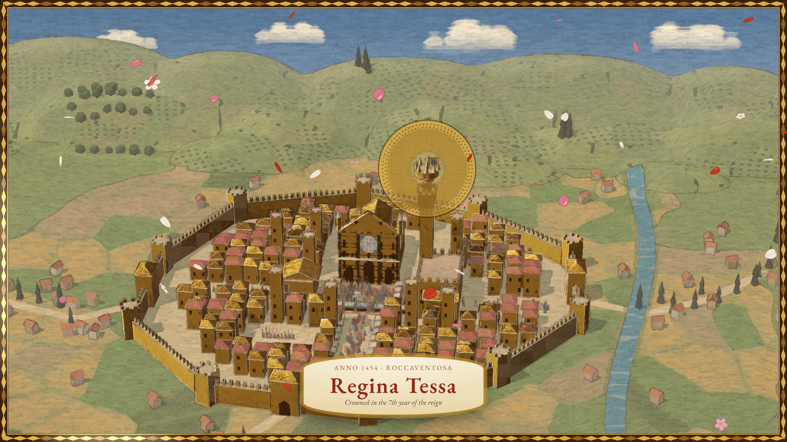
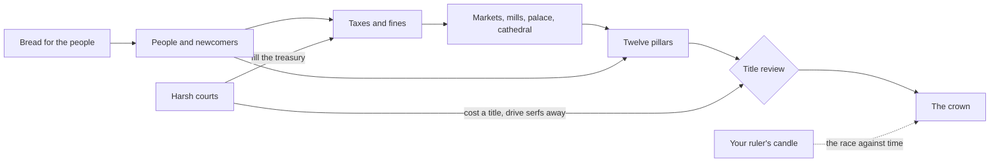

# Crown of Florins

> From knight to crown — before your candle burns out.

## The original

In 1978 George Blank wrote a city-state game for SoftSide magazine, later sold by Instant Software
as _Santa Paravia and Fiumaccio_. It took the grain-and-land arithmetic of the earlier ruler games,
added a city to build (markets, woollen mills, a palace, a cathedral) and a ladder of eight titles
to climb, and let up to six players race one another to the crown on one computer while a hidden
clock counted down each ruler's life. On screen we call it the 1978 city-state simulation.

## The hook

Everything feeds everything. Bread brings people; people bring taxes; taxes build markets and
mills, which bring more taxes and the palace and the cathedral, which bring nobles and clergy and
the next title. Harsh courts fill the treasury and take your title away. The border wants soldiers
and soldiers want pay. And somewhere a year is already written down as your ruler's last. The
question every year is the same: what can you afford to build before the bells ring?

## What it is like now

Your city-state is a Renaissance fresco that lives. It grows wall by wall as you buy land; the
cathedral rises in six visible stages over the years; the piazza fills with people when the bread is
generous and thins when it is not. Each year the season passes over the painting from dawn to dusk,
the fields turning green or ochre with the weather, the carts rolling to the granary.

You plan the year in five steps (harvest, market, bread, taxes and justice, builders), dragging
sacks between the granary and the stalls, pulling the line of the walls outward, dropping a building
card onto a lit plot, or using the precise controls beside the painting. Every number the game uses
is on the table: the twelve pillars of your title, the border watch's three conditions, the
creditors' line, and the honest odds of your ruler's death this year. Nothing is a guess dressed as
a fact.

Between years the camera pulls back and the fresco becomes a painted map of the valley, every rival's
city at its true size, its banner rising with its title. Armies march as columns of pennants along
the roads. When a ruler dies, the screen becomes a page of an illuminated manuscript that writes
itself, its candle guttering out at the foot. And on the day you are crowned, gold leaf spreads from
the crown on your palace across the whole painting, until the city is gilded and every banner in the
valley bows.

Light is a Tuscan noon in buon fresco; dark is a night of candles, with the windows lit, torches on
the walls and painted stars over the hills.

## At a glance

|             |                                                                                                           |
| ----------- | --------------------------------------------------------------------------------------------------------- |
| Players     | 1–6 on one device (hot-seat), plus AI rivals with five personalities                                      |
| A turn is   | one ruler's year, in five steps                                                                           |
| A run lasts | 20–45 years · about 30–90 minutes (it saves every year)                                                   |
| Modes       | Solo against rivals, hot-seat, the daily valley, five scenarios, Endless Dynasty                          |
| Scenarios   | Narrow Valley, Borrowed Crown, The General Next Door, Year of Fevers, Harbour Town                        |
| Daily world | yes                                                                                                       |
| Rendering   | three.js through a fresco post-process (see ARCHITECTURE.md and [ADR 0001](adr/0001-fresco-rendering.md)) |

## Why play it today

- The 1978 economy is all here, with the rules the conversion lost rebuilt and every one of them shown
  to you as it is worked out.
- Five rivals with their own ways of ruling, a dynasty that outlives you, and a race that is decided
  as often by a candle as by a cathedral.
- A painting you build, from a muddy walled town in 1400 to a gilded capital.
