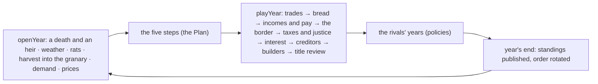
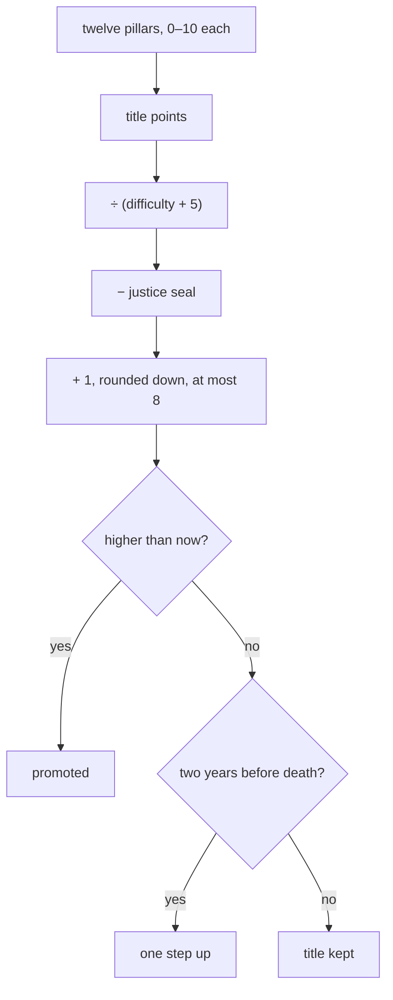

# Crown of Florins — architecture

For programmers. After reading this you should be able to change a formula, add a scenario, retune a
rival or repaint a pigment. Diagrams are Mermaid.

## Module map

```mermaid
flowchart TD
  manifest[manifest.ts] --> hall[Hall registry]
  index[src/index.ts · SimModule] --> app[src/game/app.ts · the screens' flow]
  index --> demo[src/demo.ts · the Hall's demo]
  app --> session[kit startPlay · saves, chronicle, codex]
  session --> model[src/engine/model.ts · TurnModel]
  model --> engine[src/engine · year, world, rules, policies]
  app --> stage[src/game/stage.ts · one renderer]
  stage --> scene[src/scene · city, valley, fresco, gilding]
  app --> screens[src/game/screens · menu, setup, year, harvest, review, valley, heralds, curtain, obituary, coronation, ending]
  screens --> ui[src/ui · panels, controls, heraldry, manuscript, portrait]
  app --> content[src/content · words, names, legacy, verdicts]
  engine --> kit[@one-more-year/kit]
  scene --> three[three.js]
```

| Folder / file  | What it owns                                                                                                                                                                                           |
| -------------- | ------------------------------------------------------------------------------------------------------------------------------------------------------------------------------------------------------ |
| `manifest.ts`  | The SimManifest: title, tagline, signals (title points, treasury, population, land), the seven scenarios, accents, the crown-and-florin emblem.                                                        |
| `src/engine/`  | The pure model: no DOM, no clock, no `Math.random`. State, plan, the year, the valley, rivals, bots, balance runs.                                                                                     |
| `src/scene/`   | three.js: the city generator, the valley, the hills, the painted sky and terrain, crowds, banners, armies, the fresco pass, gilding, the view and the quality ladder; the SVG valley map for the demo. |
| `src/ui/`      | DOM and SVG: the year screen's panels, tabs, scrolling bodies and controls, heraldry, the portrait, the manuscript page with its vellum and miniatures, petals, styles.                                |
| `src/game/`    | The app: flow, stage, options, sound, the year's projection and forecast, the fresco's handles, every screen.                                                                                          |
| `src/content/` | Our words: event lines, glyphs, epithets, milestones, codex, verdict lines, obituaries, names, how to play.                                                                                            |
| `src/lib/`     | Heraldry as data (tinctures, divisions, charges, the rule of tincture); the GPU check.                                                                                                                 |
| `dev/`         | The development Hall (`index.html`) and studio pages for single moments (year, valley, coronation, obituary).                                                                                          |
| `e2e/`         | Playwright specs and critique shots; tuning scripts (balance report, profiles, trace, walks).                                                                                                          |

## The model

The engine follows the 1978 program's order. A step of the kit's turn cycle is one human ruler's
year; the rivals' years between two human years are played inside `resolve`.



Every number lives in `src/engine/rules.ts`, marked _original_ (verified in NOTES.md) or _designed_
(tuned in NOTES.md).

| Quantity             | Formula                                                                                                                                                                                                      | Kind                        | Where                                         |
| -------------------- | ------------------------------------------------------------------------------------------------------------------------------------------------------------------------------------------------------------ | --------------------------- | --------------------------------------------- |
| Weather grade        | ⌈(d5 + d6 − 1) ÷ 2⌉, grades 1–5                                                                                                                                                                              | original                    | `economy.ts rollWeather`                      |
| Rats                 | d50 % of the granary, every year                                                                                                                                                                             | original                    | `economy.ts rollRats`                         |
| Worked land          | min(land, (serfs − 100 × mills) × 5)                                                                                                                                                                         | original                    | `economy.ts workedHectares`                   |
| Harvest              | worked × [0.72, 1.68, 2.64, 3.6, 4.56][grade] × (0.9–1.1) × soil                                                                                                                                             | designed                    | `economy.ts harvestFor`                       |
| Demand               | 12 serfs + 18 soldiers + 24 merchants + 24 clergy + 48 nobles bushels                                                                                                                                        | designed                    | `economy.ts demandFor`                        |
| Scarcity             | demand ÷ harvest, held to 0.8–2 (2 with no harvest)                                                                                                                                                          | original                    | `economy.ts scarcityOf`                       |
| Grain price          | (3 × (6 − grade) + 2d5) ÷ 5 × scarcity × 20 florins per 1,000 bushels                                                                                                                                        | original                    | `economy.ts grainPriceFor`                    |
| Land price           | max(0.3, ⌊(1–2) × scarcity × 10⌋ ÷ 10) florins per hectare                                                                                                                                                   | designed                    | `economy.ts landPriceFor`                     |
| Release bounds       | ⌈0.2 × reserves⌉ … ⌊0.8 × reserves⌋                                                                                                                                                                          | original                    | `plan.ts releaseBounds`                       |
| Fed                  | release ≥ demand − 1                                                                                                                                                                                         | original                    | `people.ts isFed`                             |
| Births / deaths, fed | d7 % born, then d3 % (× the scenario's death factor) die                                                                                                                                                     | original                    | `people.ts feedPeople`                        |
| Newcomers            | at release ≥ 1.3 × demand: d(min(32,000, surplus × 10 × thousands of serfs × d25 + d40)) × factor; up to 50 merchants, a noble, two clergy, +0.5 prosperity                                                  | original (fixed)            | `people.ts rollNewcomers`                     |
| Hunger               | shortfall % − 9; d3 % born, d(min(65, shortfall) + 8) % die; past 65 half the merchants go; over 1,000 dead halves prosperity                                                                                | original (fixed cap)        | `people.ts feedPeople`                        |
| Fleeing serfs        | justice 3: up to 1 % of serfs; justice 4: up to 4 %                                                                                                                                                          | original                    | `people.ts fleeingSerfs`                      |
| Willingness to pay   | max(1, 150 − customs − sales − wealth) ÷ 100                                                                                                                                                                 | original                    | `taxes.ts willingness`                        |
| Customs              | ((180 nobles + 75 clergy + 20 merchants) × willingness + 100 × prosperity) × rate × harbour                                                                                                                  | original                    | `taxes.ts revenueFor`                         |
| Sales tax            | (50 nobles + 25 merchants + 10 prosperity) × willingness × (5 − justice) ÷ 2 × rate                                                                                                                          | original                    | `taxes.ts revenueFor`                         |
| Wealth tax           | (250 nobles + 20 prosperity + 10 × justice × nobles × willingness) × rate                                                                                                                                    | original                    | `taxes.ts revenueFor`                         |
| Courts               | (300 × justice − 500) × title                                                                                                                                                                                | original                    | `taxes.ts justiceIncome`                      |
| Rents and pay        | 75 a market × rent factor; each mill 55 + d250; soldiers 3 each                                                                                                                                              | original                    | `year.ts playYear`                            |
| Interest             | a negative treasury × 1.5                                                                                                                                                                                    | original                    | `year.ts playYear`                            |
| Creditors            | below −10,000 × title: buildings gone, merchants halved, land 6,000, grain 4,000, treasury 100, prosperity 1                                                                                                 | original                    | `year.ts playYear`                            |
| Border               | invaded if soldiers < land ÷ 1,000, or a rival's published army > 2.4 × yours                                                                                                                                | original (fixed)            | `invasion.ts threatFor`                       |
| Invader              | the rival with the most soldiers among those with ≥ 1.2 per 1,000 of their own hectares; takes soldiers × 1,000 − land ÷ 3; else mercenaries 1,001–10,000; the walls keep 5,000; losses 1–40, never below 15 | original (fixed)            | `invasion.ts`                                 |
| Pillars              | markets, palace, cathedral, mills (1 each), treasury ÷ 5,000, land ÷ 6,000, merchants ÷ 50, nobles ÷ 5, soldiers ÷ 50, clergy ÷ 10, serfs ÷ 2,000, prosperity ÷ 5; each ⌊min(10, x)⌋                         | original                    | `title.ts PILLARS`                            |
| Title                | min(8, ⌊points ÷ (difficulty + 5) − justice + 1⌋); never falls; +1 two years before death                                                                                                                    | original (difficulty fixed) | `title.ts reviewTitle`                        |
| Lifetime             | accession + 20 + d35                                                                                                                                                                                         | original                    | `lifespan.ts rollDeathYear`                   |
| Odds of death        | 0 before the band, then 1 ÷ (years left in the band)                                                                                                                                                         | from the rule               | `lifespan.ts deathOdds`                       |
| Heir                 | one title lower, the city intact; aged 16–30; none if a title-1 ruler dies in debt                                                                                                                           | designed                    | `court.ts heirOf`, `year.ts heirComesForward` |



## Random streams

Every draw comes from `rngForStep(seed, step)` forked by purpose, so a new draw in one place never
reshuffles another.

| Stream label                          | Draws                                           | Used for                             |
| ------------------------------------- | ----------------------------------------------- | ------------------------------------ |
| `year:Y:seat:S` → `weather`           | two dice; `harvest` a variance draw             | the grade and the harvest            |
| `year:Y:seat:S` → `rats`              | one die of 50                                   | rats                                 |
| `year:Y:seat:S` → `prices`            | two dice; `land` a base; `mills` a die per year | grain price, land price, mill income |
| `year:Y:seat:S` → `people`            | births, deaths, merchants, newcomers, fleeing   | the people                           |
| `year:Y:seat:S` → `invasion`          | mercenaries' claim, losses                      | the border                           |
| `year:Y:seat:S` → `lifespan`          | `cause`, `heir`                                 | death and succession                 |
| `year:Y:seat:S` → `events`            | palace nobles, cathedral clergy                 | the builders                         |
| `ai:S` → `year:Y`                     | a rival's off year, the stop between purchases  | rival policies                       |
| seed → `court`, `lifespan`, `opening` | arms, names, towns, founders' lifetimes         | the start of the world               |
| `forecast:…` (kit)                    | sample streams                                  | previews only, never the real year   |

## Forecasts

`src/game/year-model.ts`. The projection is exact (costs, the granary after trade and release, the
land and the border after the trade, the road with this year's works). The forecast runs the acting
realm's `playYear` (the very function the seal runs) on 120 sample streams through the kit's
`forecastMany` and shows the range that held in 8 of 10: births, deaths, newcomers, each tax, the
courts, fleeing serfs, the mills, the title after review and the treasury at the year's end. The
rivals' years after yours cannot change yours, so they are left out of the forecast. Hidden when
the player hides forecasts in the Hall's settings.

## The rivals

`src/engine/policies.ts`. One careful ruler, `steward`, bent by `LEANINGS` per personality and a
`Temper` (aggressive, and the off-year chance from `rivalLapse(difficulty)`: 0.3, 0.1, 0.03, 0).

| Personality | Bread | Customs / sales / wealth | Justice | Kept back | Guard per 1,000 ha | Standing army | Builds first      | Saves | Buys land |
| ----------- | ----: | -----------------------: | ------: | --------: | -----------------: | ------------: | ----------------- | :---: | :-------: |
| Merchant    |  1.32 |              15 / 12 / 5 |       2 |       800 |               1.05 |             0 | markets           |  no   |    yes    |
| General     |  1.32 |              30 / 10 / 8 |       3 |       400 |                1.8 |            10 | markets, palace   |  no   |    yes    |
| Builder     |  1.32 |              30 / 12 / 8 |       2 |       300 |                1.1 |             0 | palace, cathedral |  yes  |    yes    |
| Miser       |  1.32 |             35 / 15 / 12 |       3 |     5,000 |               1.05 |             0 | markets           |  no   |    yes    |
| Saint       |  1.50 |               25 / 9 / 5 |       1 |       300 |                1.1 |             0 | cathedral         |  yes  |    yes    |

A policy sees `PolicyView` only: its realm, last year's published standings, the difficulty and the
scenario's terms. It never sees a rival's live numbers. To retune a rival, change its row in
`LEANINGS` and run `e2e/profiles.ts` and `tests/rivals.test.ts`.

## The fresco

[ADR 0001](adr/0001-fresco-rendering.md). One renderer, shared by every screen
(`src/game/stage.ts`), paints a realm's city or the valley.

```mermaid
flowchart LR
  numbers["realm numbers (cityNumbersOf)"] --> plan["planCity: walls, gates, lots, stalls, mills, crowd, guard tower"]
  plan --> build["buildCity: one geometry, surface kinds per face"]
  build --> material["pigment material: painted light, brushed walls and roofs, torches → colour + (normal, class, id)"]
  material --> mix["flat mixtures: structure tensor → blur → anisotropic Kuwahara"]
  mix --> brush["the brush: daubs along the flow, edge-stopped"]
  brush --> composite["composite: bleed and pooling · pigment shelf · pressure lines + sinopia · intonaco · patina · frame"]
  composite --> gild["gilding (coronation only): leaf on architecture"]
  gild --> screen[screen]
```



### Tuning the passes

| Pass                    | Where                                                                                                                          | The knobs                                                                                                                                                                                                                                                                   |
| ----------------------- | ------------------------------------------------------------------------------------------------------------------------------ | --------------------------------------------------------------------------------------------------------------------------------------------------------------------------------------------------------------------------------------------------------------------------- |
| Painted light           | `PAINTED_LIGHT` in `src/scene/glsl.ts`                                                                                         | the four values (`floor(t * 4.0)`), how banded (`mix(t, banded, 0.75)`), how cool the shade (`coolShade`, from the palette's `shadowTint`), how warm the lights                                                                                                             |
| Walls and roofs brushed | `cfPaint` in `src/scene/materials.ts`                                                                                          | the grade to the wall's foot (`mix(0.84, 1.05, …)`), the stroke across it (`stroke * 0.16`), the roof's slope strokes                                                                                                                                                       |
| Flat mixtures           | `KUWAHARA` in `src/scene/fresco.ts`                                                                                            | `uRadius` (the quality ladder's brush), the sector sharpness (`8000.0 * sigma2`)                                                                                                                                                                                            |
| The brush               | `STROKES` in `src/scene/fresco.ts`                                                                                             | `strokeSize` (length and breadth per class and distance, in pixels of a 1,080-line picture), `vary` (how much one stroke differs from the next), the edge stop (`smoothstep(0.16, 0.42, differ)`), `BINS` (directions), `uLayers` (1 or 2)                                  |
| Bleed and pooling       | `COMPOSITE`                                                                                                                    | the bleed offset (`3.0 / uResolution`), the pooling on the darker side (`contrast * 0.5`, at most 0.16)                                                                                                                                                                     |
| The pigment shelf       | `PIGMENT_LIST` in `src/scene/fresco.ts`, colours in `src/scene/palette.ts`                                                     | `uPull` (0.6: how far hue moves to the shelf), the open darks by day (`0.35`)                                                                                                                                                                                               |
| Lines                   | `contourAt` and `main` in `COMPOSITE`                                                                                          | `uLineWeight`, the pressure noise (`0.35 + … * 0.8 + … * 0.7`), the breaks (`smoothstep(0.14, 0.3, …)`), thinning with distance (`uFocus`)                                                                                                                                  |
| The intonaco            | `plaster` in `COMPOSITE`                                                                                                       | grain and pits, how much more in the shade (`mix(1.5, 0.75, …)`), toward the frame (`rim`), the trowel's bands, giornate, cracks (`settled`)                                                                                                                                |
| Hills                   | `src/scene/hills.ts` (`layHills`, `cushion`, `HILL_PAINT`), rows in `cityHills` (`terrain.ts`) and `valleyHills` (`valley.ts`) | rows' depth, height, width and spacing; the cushion's profile; field, grove and cypress density; the air's veil (`far`)                                                                                                                                                     |
| Sky, clouds, moon       | `src/scene/sky.ts`                                                                                                             | the band (`setHorizon`), cloud size and lobes (`cloudShape`), the soft edge (`smoothstep(0.1, -0.14, d)`), the moon's radius (`uMoon.z`) and halo                                                                                                                           |
| The gold                | `src/scene/gilding.ts`                                                                                                         | `AMBER`, `BODY`, `BRIGHT`, `PALE` (the metal's ramp), the curve (`pow(…, 1.35)`), the key light (`KEY`), sheet size (`uResolution.y / 34`), the travelling streak (`band`), what is gilded (`cfInfoClass` in `materials.ts`: the share of roofs kept vermilion is `> 0.42`) |
| Armies                  | `src/scene/armies.ts`                                                                                                          | figures per soldier (`columnSize`), files and gaps, pennants every few ranks, dust strokes (`dustGeometry`), the swirl's radius                                                                                                                                             |

| To change                                 | Edit                                                                                                                           |
| ----------------------------------------- | ------------------------------------------------------------------------------------------------------------------------------ |
| A pigment, the plaster, the haze, the sun | `src/scene/palette.ts` (`NOON`, `CANDLES`)                                                                                     |
| The brushwork or the contour lines        | `src/scene/fresco.ts` (uniforms and shaders)                                                                                   |
| How a building looks or grows             | `src/scene/city.ts` (`buildPalace`, `buildCathedral`, …)                                                                       |
| Where things stand in the city            | `src/scene/layout.ts` (`planCity`)                                                                                             |
| The hills                                 | `src/scene/hills.ts`; each picture's rows in `terrain.ts` (`cityHills`) and `valley.ts`                                        |
| The valley's sites, river, roads, bridges | `src/scene/valley.ts` (`CITY_SITES`, `RIVER`, `roadBetween`, `bridgeSites`)                                                    |
| The armies on the road, the clash         | `src/scene/armies.ts`; the camera's ease and the ribbon in `src/game/screens/valley.ts`                                        |
| The banners' bow                          | `src/scene/valley.ts` (`bow`, and the loser's dip in `placeArmies`); the banner in `banners.ts`                                |
| Where a city flies its banner             | `src/scene/city.ts` (`bannerPointFor`: palace tower, hall, guard tower, gate tower)                                            |
| The gold                                  | `src/scene/gilding.ts`; what is gilded in `cfInfoClass` (`src/scene/materials.ts`)                                             |
| The petals                                | `src/ui/petals.ts`, their fall and tumble in `src/ui/crown.css`                                                                |
| A coat of arms' colours or charges        | `src/ui/heraldry-svg.ts`, rules in `src/lib/heraldry.ts`                                                                       |
| The portrait                              | `src/ui/portrait.ts`                                                                                                           |
| The obituary page                         | `src/ui/manuscript.ts`; vellum in `src/ui/vellum.ts`; miniatures in `src/ui/miniatures.ts`; words in `src/content/obituary.ts` |
| A sound                                   | `src/game/sound.ts` (`SOUND`, the recipes)                                                                                     |
| A line of the scroll or the chronicle     | `src/content/text.ts` (`EVENT_TEXT`)                                                                                           |
| An epithet, milestone or codex entry      | `src/content/legacy.ts`                                                                                                        |
| A verdict's lines                         | `src/content/verdicts.ts`                                                                                                      |
| A panel's colours                         | the tokens at the top of `src/ui/crown.css` (both appearances; `tests/contrast.test.ts` checks AA)                             |

Light (buon fresco) and dark (candles) are two palettes, not a recolour: the sun, the shadows'
earth, the sky (painted stars and a moon at night), lit windows and torches, the plaster's patina.
The valley's night is a moonlit painting: its land keeps the daytime pigments under a brighter
moon, and every town spills lamplight onto the fields around it. At night the gold is lit by the
torches the painting holds, warm where they are and deep in the shadows. The leaf spreads eased in
(progress^1.6), so it creeps out from the crown before it gathers pace. Reduced motion: no camera
moves, the season and the valley become short fades, a march becomes three still beats (on the
road, the clash, the result), crowds still, the gold appears in one fade, the petals lie still.

### The obituary page

Vellum (`src/ui/vellum.ts`) is SVG filters: the skin's fibre along the page, sparse follicle
specks, a soft mottle, edges darker where hands held it, and a cockle lit from the upper left. The
margin's miniatures (`src/ui/miniatures.ts`) are painted from the event they tell (as many stalls as
markets, the cathedral as far as it rose, the realm's own colours on banners and robes, the
coronet's points from the title) in the fresco's pigments, modelled in a light and a hatched shade,
on a ground of gold leaf with a crackle, a punched border and a passing glint.

**Quality ladder** (`src/scene/quality.ts`): high, balanced, light change the brushwork's
resolution (1, 0.75, 0.5) and Kuwahara radius (5, 4, 3), the stroke directions crossed at each
pixel (2, 2, 1), the plaster (all of it, all of it, grain only), the shadow map (4,096, 2,048,
1,024), the crowd share (1, 0.7, 0.4) and the render resolution (1, 1, 0.85). It steps down after
two seconds of slow frames and tries one level up after eight comfortable seconds, never above the
player's choice.

**Frame rates** (`e2e/shots/critique.spec.ts`, run alone on one worker, frame cap lifted so the
numbers show headroom; the development machine's RTX 4060 laptop GPU through ANGLE Direct3D 11;
the median of eight seconds; measured 2026-11-08 after prompt 02a's stroke pass):

| Scene                | Size      | High | Balanced | Light |
| -------------------- | --------- | ---: | -------: | ----: |
| Valley               | 1280×720  |  136 |      197 |   441 |
| Valley               | 1920×1080 |   66 |       92 |   209 |
| Invasion (the clash) | 1280×720  |  144 |      210 |   500 |
| Invasion (the clash) | 1920×1080 |   67 |      100 |   233 |
| Coronation           | 1280×720  |  192 |      230 |   514 |
| Coronation           | 1920×1080 |   70 |      107 |   275 |

The stroke pass and the fuller plaster cost about a tenth at high and balanced against prompt 02's
numbers (valley 75 → 66, coronation 75 → 70 at 1920×1080, high); light got faster (189 → 209),
because it now lays one stroke direction and paints the plaster's grain alone. Every level holds 60
fps at 1920×1080 here; a mid-range laptop with an integrated GPU is expected to settle on balanced
or light, which the ladder does by itself.

## The year screen

`src/ui/year-screen.ts`, on a 12-column grid (3 · 6 · 3). Every panel fits above the rival bar at
1280×720 and 1920×1080 (`e2e/specs/layout.spec.ts`): the court's ruler and realm share a card of
tabs (`src/ui/tabs.ts`), as do the glass box's road, border watch and debt (a mark on a tab when
the border is open or the treasury owes); a step panel's body scrolls inside its card with a
"more below" mark (`src/ui/scroll.ts`). Headings are small capitals with the first letter in lapis
inline; illuminated initials belong to the obituary and the chronicle. "Seal the year" is in the
step bar only. The title review is told by name (`titleWords`), and the treasury one way:
_after this plan_ (exact) and _expected at the year's end_ (the forecast), with the year's money
line by line on hover or focus. Once a rival has won the race, the step bar carries a ribbon
(`raceWon` in `src/game/year-model.ts`) and the rival bar marks every crown, first or later.

## Sound

All synthesised with the kit's audio engine (`src/game/sound.ts`): a plucked, lute-like motif for
each step (a Karplus–Strong string through a delay), bells for promotions (three rising), a single
low bell three times for a death, a peal for the coronation with a soft choir pad, masons' taps, a
war drum for an army on the road, a quill's scratch while the obituary is lettered, the crowd's
murmur scaled by population, a grain pour, and a dull knock for a drop that is not allowed. The
ambience is a warm low room with a faint open fifth.

## Contract usage

- `startPlay(ctx, PLAY_RULES, launch)` (`src/game/play-rules.ts`): the model, event text, epithets,
  milestones, the chronicle's title, glyphs and share line, `dailyScenario` (the 1978 valley), and
  `presentation: 'game'`.
- The court the player sets up travels in `WorldSetup.options` (kit ADR-0009), so a resumed run and
  "Replay this world" seat the same people. A launch from the Hall without options uses the last
  court the player set up, if it has the same number of humans, or a quick court from the seed.
- `setView`: `menu` on the menu, setup and scenarios; `plan` on the year screen; `report` for the
  season, the scroll, the valley, the curtain, the obituary and the coronation; `results` on the
  dynasty. Pause items: Ledger, Codex, the game's options, and in Endless Dynasty "Close the
  chronicle".
- How each year reads on the chronicle's strip is the kit's `toneOf` over the year's events, so it
  follows the severities set in `src/engine/year.ts`: a drought, a famine, an invasion, the
  creditors or the end of the line make a disaster year; a poor harvest, interest on debt, a rival
  crowned first, a ruler's death, merchants leaving, a real flight of serfs or ruinous rats (two
  fifths of a granary that held a fifth of the year's bread or more) make a hard one. Rats in an
  ordinary year are news, not hardship. A careful reign reads about half good, a quarter hard, an
  eighth disaster.
- The run is reported once, when it ends; the dynasty screen then hands over with
  `ctx.navigate({ results: chronicle.id })` (ADR-0008).
- Milestones the session checks at the run's end are in `MILESTONES` with `atRunEnd`; the rest are
  unlocked by the app as they happen (Every Sky, The Twelve Pillars, Every Way of Ruling, Campanile,
  For Long Service, A Full Table, Sixty Winters, Kept in the Archive).
- The demo (`src/demo.ts`): `createModelDemo` with the `demo` scenario (four AI rivals alone, a year a
  step every three seconds), signals of the leading realm; the fresco valley in the diorama style
  with a GPU, the SVG map otherwise.

## Saves

Save version 1. A run's state is the `World` (version 1): realms, order, standings, the scenario's
terms, the end. Plans and states are plain JSON. No migrations yet.

## Tests

| Suite                             | Guards                                                                                                                                                                                                                                                                                                                                                                        |
| --------------------------------- | ----------------------------------------------------------------------------------------------------------------------------------------------------------------------------------------------------------------------------------------------------------------------------------------------------------------------------------------------------------------------------- |
| `tests/rules.test.ts`             | each verified 1978 rule, stated in our words: weather spread, title formula, justice penalty, deathbed, bread bounds, the opening ledger, courts, the creditors' line, interest, the border                                                                                                                                                                                   |
| `tests/balance.test.ts`           | the prompt's targets: competent 30–55 % in 25–35 years, naive never crowned and ruined < 40 %, seats within 5 points, chance never crowned                                                                                                                                                                                                                                    |
| `tests/difficulty.test.ts`        | each level lowers the crown rate by ≥ 4 points, Grand Master ≥ 8 %, rivals sharper at Grand Master                                                                                                                                                                                                                                                                            |
| `tests/rivals.test.ts`            | recognisable profiles, every personality beats the naive bot, no rival peeks                                                                                                                                                                                                                                                                                                  |
| `tests/scenarios.test.ts`         | each scenario winnable (≥ 15 %) and changing what it says; Endless Dynasty; the end of a line                                                                                                                                                                                                                                                                                 |
| `tests/determinism.test.ts`       | replays from seed and plans (solo and hot-seat), the court in the setup, the daily world in two contexts                                                                                                                                                                                                                                                                      |
| `tests/scene.test.ts`             | walls grow with land, stalls, cathedral stage, palace pieces, mills, crowd, guard tower, the quality ladder; nothing of the valley's land (bridges, trees, farmsteads) inside a town, the river between the towns; the hills rounded, each town's its own                                                                                                                     |
| `tests/race.test.ts`              | the end of the race: who won it, the chronicle closable only once it is won, a later crown told as later, the step bar's ribbon and the rival bar's crown, the heralds' two choices                                                                                                                                                                                           |
| `tests/heraldry.test.ts`          | six seats' arms distinct (ΔE > 20 between fields) and legible (≥ 3 : 1), the editor keeps the rule of tincture                                                                                                                                                                                                                                                                |
| `tests/contrast.test.ts`          | every text colour AA in both appearances                                                                                                                                                                                                                                                                                                                                      |
| `tests/content.test.ts`           | a line for every event, a codex entry for every sighting, glyph priority, Legacy counts                                                                                                                                                                                                                                                                                       |
| `tests/ui.test.ts`                | the year screen, one "Seal the year", headings without boxed initials, the title review by name, the treasury told one way, the tabs' keys, the controls' keys, the curtain holding no numbers                                                                                                                                                                                |
| `e2e/specs/*.spec.ts` (port 5481) | to the crown; death and heir; Classic fate; bankruptcy and recovery; an invasion; hot-seat privacy; a rival crowned (play on, end here); Daily; a scenario; Endless Dynasty for 60 years; a year by keyboard and by mouse; resume after reload; replay with a ghost; every way out; axe in both appearances; every panel above the rival bar at both sizes (`layout.spec.ts`) |
| `e2e/shots/critique.spec.ts`      | the critique screenshots and frame rates (`SHOTS=1`)                                                                                                                                                                                                                                                                                                                          |

```
pnpm --filter @one-more-year/crown-of-florins e2e
pnpm --filter @one-more-year/crown-of-florins shots
```

## Adding a scenario

1. Add a `Scenario` to `SCENARIOS` in `src/engine/scenarios.ts` (terms, start changes, end year)
   and, if curated, to `CURATED_SCENARIOS`.
2. Add its `ScenarioSummary` to `manifest.ts`.
3. Add a test in `tests/scenarios.test.ts` that it starts as described, and run
   `e2e/balance-report.ts 2000 scenarios` to check it stays winnable.
