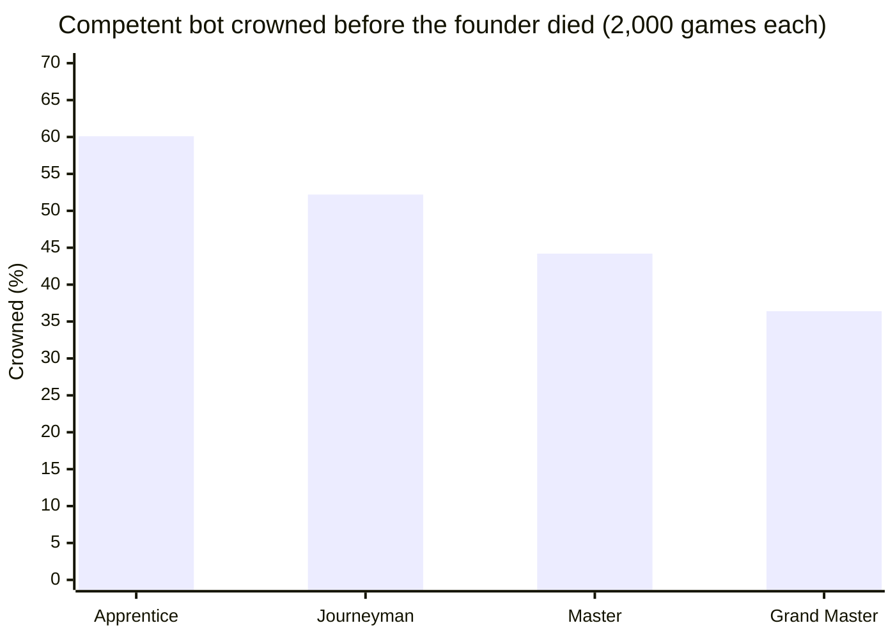
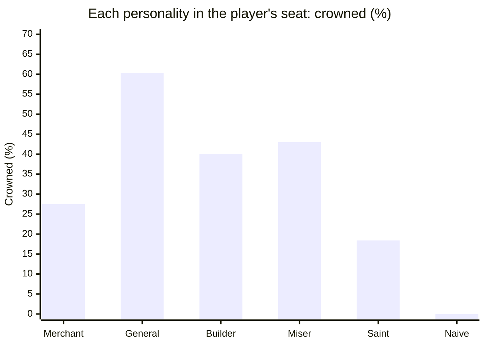

# Crown of Florins — notes

Working notes the other documents cite. Facts about the 1978 program are read from its IBM PC BASIC
conversion outside this repository and written here in our own words; no line, message, name or
table is copied. Line numbers refer to that listing.

Status: the source reading, the designed economy and its tuning are complete and locked as tests
(`tests/balance.test.ts`, `tests/difficulty.test.ts`, `tests/rivals.test.ts`,
`tests/scenarios.test.ts`). Every number below can be reproduced with the commands under
"Reproducing the numbers".

## Sources

- `santaparavia.bas`, an IBM PC BASIC conversion (455 lines), in `E:\Projects\simulation\src`,
  read-only, never copied into the repo.
- Published credits are in `CREDITS.md` (George Blank, SoftSide, 1978; Instant Software).

## Verified behaviour of the original

Read in the listing and traced by hand.

- **Players and start** (320–323, 400–420, 101): one to six players; the first year is 1400. Every
  player starts alike: 2,000 serfs, 25 soldiers, 25 merchants, 5 clergy, 4 nobles, 10,000 hectares,
  5,000 measures of grain, 1,000 florins; customs 25 %, sales 10 %, wealth tax 5 %, justice 2
  (moderate); the lowest title; an "economic health" figure of 1 (we call it prosperity).
- **Turn order** (600–640): every year the players act in seat order, seat 1 first, always.
- **Lifetimes** (400, 640–645, 1100–1200): each ruler's last year is drawn at the start, 1420 plus a
  die of 35 (1421–1455). In that year the ruler dies at the start of their turn and the turn is lost;
  the cause is rolled on a die of eight, and old age is named only after 1450. A single-player game
  ends with the death; otherwise the game ends when every player is dead.
- **Deathbed promotion** (7140): in the year two before a ruler's death the title rises one step,
  whatever the points say.
- **Weather** (2000–2100): two dice, one of five faces and one of six, averaged, less a half, assigned
  to an integer: five grades from drought to excellent.
- **Rats** (2110–2120): every year rats eat 1–50 % of the grain reserves.
- **Grain price** (2230–2240): (3 × (6 − grade) + two dice of five) ÷ 5 × scarcity × 20, in florins
  per thousand measures; scarcity is demand over harvest held between 0.8 and 2 (2200–2210), and 2
  when nobody can work the land (2140).
- **Trading** (2600–2880): grain is bought and sold at that price; land at the land price. Grain sold
  cannot exceed the reserves; land sold must leave 5,000 hectares. Nothing checks the treasury when
  buying: spending past it is debt.
- **Releasing grain** (4000–4030): at least a fifth of the reserves and at most four fifths.
- **People, when fed** (4100–4130, 1500–1510): released at least demand less one: 1–7 % of serfs born,
  then 1–3 % die; with customs plus sales below 35 %, 1–4 merchants arrive.
- **Newcomers** (4200–4280): (released − demand) ÷ demand × 10, times the serfs in thousands, times a
  die of 25, plus a die of 40, capped at 32,000; then a die of that size arrive. Prosperity rises by
  a half; up to 50 merchants (a die of a fifth of the newcomers), one noble and two clergy come with
  them.
- **Hunger** (4500–4530): the shortfall in percent, less 9; past 65, half the merchants leave; 1–3 %
  born and up to (shortfall + 8) % die; a famine that kills more than 1,000 halves prosperity.
- **Harsh justice** (4300–4340): at harsh justice up to 1 % of serfs flee, at outrageous up to 4 %.
- **Income and pay** (4900–4930): 75 florins a year from each marketplace; the mills together earn
  (55 + a die of 250) each; every soldier is paid 3 florins.
- **Invasion** (4940–4970, 8100–8290): a player is invaded when the land in thousands exceeds the
  soldiers, or by the rival test discussed below. The invader is the rival with the most soldiers
  among those with at least 1.2 soldiers per thousand of their own hectares; it takes its soldiers ×
  1,000 less a third of its land. If no rival qualifies a named outsider comes and takes 1,001–10,000
  hectares. A seizure that would reach the last 5,000 hectares takes half of what lies beyond
  instead. The defender loses 1–40 soldiers, not below 15.
- **Taxes and justice** (2400–2550, 3200): a shared factor 150 − (customs + sales + wealth), at least
  1; customs from nobles, clergy and merchants plus prosperity; sales from nobles, merchants and
  prosperity, weighted by (5 − justice) ÷ 2; wealth tax from nobles and prosperity plus a justice
  term; each taken at its rate. Justice brings in (300 × level − 500) × title. Revenue is added after
  the people's year.
- **Debt** (3210–3220, 8000–8050): a negative treasury is multiplied by 1.5 each year; below −10,000
  times the title the creditors seize all markets, mills, palace and cathedral, set land to 6,000,
  prosperity to 1, treasury to 100, grain to 4,000, and halve the merchants.
- **Purchases** (6000–6550): marketplace 1,000 (5 merchants, +0.1 prosperity); woollen mill 2,000
  (+0.25); a piece of palace 3,000 (+0.5); a piece of cathedral 5,000 (1–6 clergy, +1); a platoon 500
  (20 serfs become soldiers). Nothing checks the treasury.
- **Title review** (7000–7190, 7500): twelve pillars — markets, palace pieces, cathedral pieces,
  mills, treasury ÷ 5,000, land ÷ 6,000, merchants ÷ 50, nobles ÷ 5, soldiers ÷ 50, clergy ÷ 10,
  serfs ÷ 2,000, prosperity ÷ 5 — each capped at 10 and rounded down (the treasury's can be
  negative). The title is points ÷ (difficulty + 5) − justice + 1, rounded down, at most 8; it never
  falls. Reaching the top title wins.
- **The map** (5000–5950): the wall's corner moves out in bands of land; a guard tower stands when
  soldiers − 5 cover the land in thousands, with a fuller tower when half the soldiers do; the
  cathedral is drawn in six cumulative stages; the palace grows with its pieces; the ploughman stands
  higher as more land is worked; markets and mills are drawn in rows.
- **Standings** (1000–1060): a screen shows every player's classes, land and treasury.

## Quirks and bugs

Each is kept or fixed as described in `CHANGES-FROM-ORIGINAL.md`; the engine follows the verdicts
below.

| Where         | What the conversion does                                                                                                                                               | Verdict                                                                               |
| ------------- | ---------------------------------------------------------------------------------------------------------------------------------------------------------------------- | ------------------------------------------------------------------------------------- |
| 550–580, 7130 | The difficulty answer goes into a plain variable; the array element the title uses is never set, so every game runs at the easiest level.                              | Fixed: four levels divide by 6, 7, 8, 9.                                              |
| 2130–2220     | Harvest and demand are never computed (their lines are missing): both stay zero.                                                                                       | Designed (below).                                                                     |
| 2200          | Demand ÷ harvest is 0 ÷ 0; the interpreter carries on with an infinite value, so scarcity is always held at 2 and grain is always priced as if scarce.                 | Fixed by the designed harvest and demand.                                             |
| 2220          | The land price is multiplied by scarcity but never given a value: land costs nothing, forever.                                                                         | Designed (below).                                                                     |
| (none)        | No line adds the harvest to the reserves.                                                                                                                              | Fixed: the harvest is stored before the year's decisions.                             |
| 4040–4080     | A growth factor from the release and the taxes is computed and then overwritten before use.                                                                            | Left out: nothing tells what it was for.                                              |
| 4100          | With demand zero the hunger branch can never run: everyone is always fed.                                                                                              | Fixed by the designed demand.                                                         |
| 4140          | The newcomers test compares the wealth-tax rate with demand (wrong variable); with demand zero, and the surplus divided by zero, 1–32,000 newcomers arrive every year. | Fixed: the test uses the grain released.                                              |
| 4500          | The hunger death roll is capped at 65 + 8 on a copy, but the uncapped value is used.                                                                                   | Fixed: the cap applies.                                                               |
| 4945          | A second land test is always implied by the first.                                                                                                                     | Dropped (it changes nothing).                                                         |
| 4960          | The rival test is inverted: you are invaded if any rival has fewer than 2.4 times your soldiers, so in a game of two or more everyone is invaded every year.           | Fixed: a rival with more than 2.4 times your soldiers is the threat.                  |
| 5120          | A comment swallows the next statement: the guard tower's base is never drawn.                                                                                          | Fixed in the fresco: base and top.                                                    |
| 5333          | A comment swallows the second head of the plough team.                                                                                                                 | Not applicable (no plough team in the fresco).                                        |
| 6300          | A comment swallows the line that gives a palace piece 1–2 nobles.                                                                                                      | Fixed: palace pieces bring 1–2 nobles.                                                |
| 7140–7190     | A deathbed step that reaches the top title skips the win check, and the title's name is not updated.                                                                   | Fixed: it crowns, and the screen says so.                                             |
| 8205          | When no rival can march, a named outsider invades.                                                                                                                     | Replaced by an anonymous band of mercenaries.                                         |
| 8260          | Losses are capped at soldiers − 15, which turns into a gain below 15 soldiers.                                                                                         | Fixed: no loss below the garrison, never a gain.                                      |
| 8040          | Bankruptcy sets land to 6,000 even for a realm with less.                                                                                                              | Kept.                                                                                 |
| 380, 520      | The sex and instructions questions accept lower-case answers only.                                                                                                     | Not applicable: a title form is chosen per ruler.                                     |
| 3120–3180     | An out-of-range sales tax becomes 5 %, a wealth tax 0 %, a justice level 1.                                                                                            | Not applicable: the controls cannot leave their ranges.                               |
| 4000 vs 3000  | The people's year uses last year's rates; this year's are set afterwards.                                                                                              | Changed: the plan's rates apply to the whole year, so the preview and the year agree. |
| 600–630       | Seat 1 always acts first.                                                                                                                                              | Changed: the order rotates each year.                                                 |
| 2000          | Halves are rounded when the weather is assigned; "rounded up" gives grades 3, 7, 10, 7, 3 in 30, the symmetric spread the converter's comment aims for.                | Kept as that spread.                                                                  |

## The reconstructed economy (designed, tuned and locked)

The verdict on the source: everything listed under "Verified behaviour" is kept with its constants,
and the pieces the conversion lost (harvest, demand, the land price, the harvest reaching the
reserves) are designed for this game. Every designed formula is one named function in
`src/engine/economy.ts`, with its constants in `src/engine/rules.ts`, each marked _designed_ there.

| Piece       | Designed formula (locked)                                                                                                                                                      | Why                                                                                                                                                  |
| ----------- | ------------------------------------------------------------------------------------------------------------------------------------------------------------------------------ | ---------------------------------------------------------------------------------------------------------------------------------------------------- |
| Worked land | min(land, (serfs − 100 × mills) × 5): the conversion's own relation (2130), kept.                                                                                              | Serfs are the labour; mills take hands from the fields.                                                                                              |
| Harvest     | worked × yield(grade) × (0.9 + 0.2 × a draw); yields 0.72, 1.68, 2.64, 3.6, 4.56 bushels a hectare from drought to excellent.                                                  | A fair year feeds the 1978 starting realm almost exactly; a drought brings in barely a quarter of that, and two poor years empty a careless granary. |
| Demand      | serfs 12, soldiers 18, merchants 24, clergy 24, nobles 48 bushels a year.                                                                                                      | Releasing less starves people and more draws newcomers, as the working code intends; the classes eat in proportion to their station.                 |
| Land price  | a yearly base drawn between 1 and 2 florins a hectare, × scarcity (the same demand ÷ harvest the grain price uses), to one decimal, never below 0.3.                           | Scarce grain makes land dear; never zero, as the conversion's lost line left it.                                                                     |
| Reserves    | the harvest goes into the granary at the opening of the year, after the rats.                                                                                                  | The conversion never stored it.                                                                                                                      |
| Heirs       | an heir takes the throne one title step lower, with the city intact; lifetime by the same rule from their accession (20 + a die of 35 years), aged 16–30 on taking the throne. | Dynasty, the owner's choice; the 1978 program had no heirs.                                                                                          |
| No heir     | a Cavaliere or Dama who dies with the treasury in debt leaves no heir: the line ends.                                                                                          | Bankruptcy and invasion can end a dynasty, as the design asks.                                                                                       |

Tuning went in this order, each step checked with 400 seeded games before the 2,000-game runs:
yields and rations together until a fair year just feeds the start; then the land price band until
buying land for idle hands paid back within a reign; then the bots (below) until the competent
one met the targets. The first proposal (yields a fifth of these, rations a sixth) crowned the
competent bot in every game, in a median of 19 years.

## The bots

All of them fill in the same plan a player does and see only what a player sees (`PolicyView`: the
realm, last year's published standings, the difficulty and the scenario's terms).

- **Competent** (`steward`): counts the year's income cautiously, keeps a guard for the land and
  against the strongest rival (with a margin for a platoon of growth), feeds everyone, draws
  newcomers when the extra bread is affordable, lays by cheap grain, sells a glut, buys land for idle
  hands, sells outer fields when deep in debt, and builds markets, mills, the palace and the
  cathedral in that order with what is left. Justice is very fair only in a year it wins a title.
- **Naive**: the opening plan every year (bread to the need, taxes 25 / 10 / 5, justice 2), never
  trades, never builds.
- **Builder**, **General**: two of the AI personalities playing for themselves.
- **Random**: every number drawn at random within its limits.

## Balance (2,000 seeded games per configuration)

Four seats (the bot and three rivals drawn from the five personalities), Classic fate, seeds 1–2000.
A crown counts only if it comes before the founder's death.

| Configuration         | Crowned | Median years | Bankrupt | Invaded | Bankrupt or invaded |
| --------------------- | ------: | -----------: | -------: | ------: | ------------------: |
| Competent, Journeyman |  52.2 % |           33 |      0 % |     0 % |                 0 % |
| Naive, Journeyman     |     0 % |            — |      0 % |  29.4 % |              29.4 % |
| Builder bot           |  40.0 % |           37 |      0 % |     0 % |                 0 % |
| General bot           |  60.3 % |           32 |      0 % |     0 % |                 0 % |
| Random bot            |     0 % |            — |    100 % |     0 % |               100 % |

Targets (prompt §3.1) and where they stand: competent 30–55 % ✓ (52.2), median 25–35 years ✓
(33); naive never crowned ✓, bankrupt or invaded under 40 % ✓ (29.4).

**Seats.** The competent bot sat in each seat in turn (500 games each): crowned 53.2 %, 55.2 %,
53.0 %, 52.2 % — no seat more than 1.7 points from the average (target ±5). Turn order rotates every
year, so no seat always goes first.

**Difficulty.** Each level divides the points by one more and sharpens the rivals:



| Level        | Divisor |  Rivals' off years | Crowned | Median years |
| ------------ | ------: | -----------------: | ------: | -----------: |
| Apprentice   |       6 |       one in three |  60.1 % |           30 |
| Journeyman   |       7 |         one in ten |  52.2 % |           33 |
| Master       |       8 | three in a hundred |  44.2 % |           36 |
| Grand Master |       9 |              never |  36.4 % |           39 |

Each step lowers the crown rate by about eight points; Grand Master stays winnable (target ≥ 8 %).

## The AI rivals

Five personalities, each the careful ruler bent by its leanings (`LEANINGS` in
`src/engine/policies.ts`): bread, the three taxes, the seal of justice, money kept back, guard per
1,000 hectares, a standing army, the order of building, whether it saves for its first choice, and
whether it buys land.

Each as the bot in the player's seat (2,000 games, Journeyman):



Their profile after thirty years, in courts of the five alone (2,000 games, Journeyman):

| Personality | Soldiers | Soldiers / 1,000 ha | Customs | Tax burden | Justice | Markets | Mills | Palace + cathedral | Treasury | Title |
| ----------- | -------: | ------------------: | ------: | ---------: | ------: | ------: | ----: | -----------------: | -------: | ----: |
| Merchant    |       45 |                 3.2 |    15 % |       32 % |       2 |     6.6 |   3.0 |                0.6 |    3,869 |  2.38 |
| General     |       53 |                 2.9 |    30 % |       48 % |       3 |     9.7 |   6.4 |               10.4 |    8,144 |  4.88 |
| Builder     |       45 |                 2.4 |    30 % |       50 % |       2 |     3.6 |   0.0 |                6.8 |    4,835 |  2.99 |
| Miser       |       45 |                 3.1 |    35 % |       62 % |       3 |     7.5 |   5.9 |                4.3 |   10,163 |  3.21 |
| Saint       |       45 |                 3.1 |    25 % |       39 % |       1 |     5.4 |   0.1 |                0.9 |    3,473 |  2.55 |

What makes each recognisable, locked in `tests/rivals.test.ts`: the General holds the largest
armies (more than twice its share of the valley's top fifth by army size); the Merchant taxes trade
lightest and spends the most on markets and mills; the Builder spends the most on the palace and the
cathedral; the Miser keeps the fullest treasury under the heaviest taxes; the Saint keeps the
mildest courts. Every one of them, in the player's seat, is crowned in more than a tenth of games and
ends a title higher than the naive bot on average.

Two findings from the tuning, kept in the design:

- The 1978 justice line pays well: harsh courts bring in 400 florins a year per title step against
  the moderate 100. The General's harsh justice is a large part of why it is the strongest rival.
- Soldiers per hectare is not what tells the General apart: every careful ruler arms to stand within
  2.4 times the strongest army, so the valley's armies follow the General's. Its own army is what
  stands out. (A General armed at 3 per 1,000 hectares pushed the naive bot's invasions to 60 %, so
  it keeps 1.8 and a standing ten.)

**No peeking.** A rival's plan comes from `PolicyView` alone. Tests change its ruler's hidden death
year and the rivals' live numbers beyond the published standings, and the plan stays the same.

**Skill by difficulty.** At Apprentice a rival has an off year one time in three (no building, no
land, bread only to the need); at Grand Master never. In thirty-year courts of rivals alone, a Grand
Master's rivals build at least a tenth more title points than an Apprentice's.

## Scenarios

Each changes a few switches (`Terms` in `src/engine/scenarios.ts`) and the start; nothing else.
Competent bot, 2,000 games, Journeyman (target: crowned in at least 15 %):

| Scenario              | What changes                                                                           | Crowned | Median years |
| --------------------- | -------------------------------------------------------------------------------------- | ------: | -----------: |
| Narrow Valley         | 6,500 hectares each; yields × 1.4                                                      |  60.4 % |           30 |
| Borrowed Crown        | you begin as Barone, 6,000 florins in debt                                             |  42.3 % |           34 |
| The General Next Door | the General starts with 55 soldiers and arms a platoon a year toward 2.4 × the weakest |  48.5 % |           34 |
| Year of Fevers        | fed-year deaths × 2, newcomers × 0.5; ends in 1460                                     |  66.6 % |           31 |
| Harbour Town          | no land for sale; customs × 1.2, market rent × 1.25                                    |  49.5 % |           32 |

Year of Fevers is not harder for a careful ruler: the classes that pay taxes are the merchants,
nobles and clergy, and fewer serfs means less bread to buy. It punishes the ruler who lets people go
hungry, whose famine deaths are not softened by the fever. Its manifest difficulty stays "standard".

## The end of the race

The 1978 program ends the whole game the moment any player reaches the top title (7190 jumps to
the crowning at 7600, which ends the game at 11000). It has no computer rivals, so the first crown
is always a player's. Prompt 02 §3.7 keeps the race and lets the others play on. The engine
(`src/engine/world.ts`, `sealYear` and `playStep`) does exactly this:

- **The race** is won by the first realm whose title review reaches Re or Regina:
  `world.firstCrowned` records its seat, once, and never changes after.
- **A player crowned** (any human seat) ends the game at once, in every scenario but Endless
  Dynasty (`terms.crownEnds`). The verdict is "First Crown of the Valley" when that player won the
  race, "A Crown Worth the Wait" when a rival had.
- **A rival crowned first** does not end the game. Every human hears it at once: the heralds'
  announcement in the valley interlude (or over the city when the valley is off), then a ribbon in
  the step bar for the rest of the game ("Roccaventosa crowned Regina Selvaggia, 1443"), and a
  crown on the winner's card in the rival bar. The announcement offers the choice the rule allows:
  _Play on for your own chronicle_, or _End here and see the chronicle_. Ending closes the
  chronicle as Endless Dynasty does (`plan.retire`, ending `retired`, verdict by the best title the
  line reached); the pause menu keeps "Close the chronicle" from then on, so the choice is never
  lost. Before the race is won, outside Endless Dynasty, a plan's `retire` is ignored.
- **A second rival crowned.** The title review is one rule for every realm, so a rival can reach the
  top title after the race is won, and keep playing: rivals are the valley's living cities, and a
  crowned one still trades, arms and marches. This is intended: the race decides who was first,
  not who may be crowned. It is now told honestly: the valley's news says "crowned its ruler too, a
  crown won after Roccaventosa's", and the rival bar marks it "crowned 1457", not "first crowned".
  A rival's crown never ends the game and never changes a player's verdict except to make a later
  crown "A Crown Worth the Wait".

Locked in `tests/race.test.ts` (seed 51, the default solo court, where a rival is crowned in 1425
while the player keeps the year screen's own plan) and in the end-to-end flows "when a rival is
crowned…" (both choices). `e2e/race-seed.ts` finds such seeds.

## Reproducing the numbers

```
npx tsx games/crown-of-florins/e2e/balance-report.ts 2000 core difficulty bots personalities scenarios
npx tsx games/crown-of-florins/e2e/profiles.ts 2000 30 2
```

The 2,000-game report takes about eight minutes on a laptop; the tests run 300–400 games per
configuration with tolerances.
