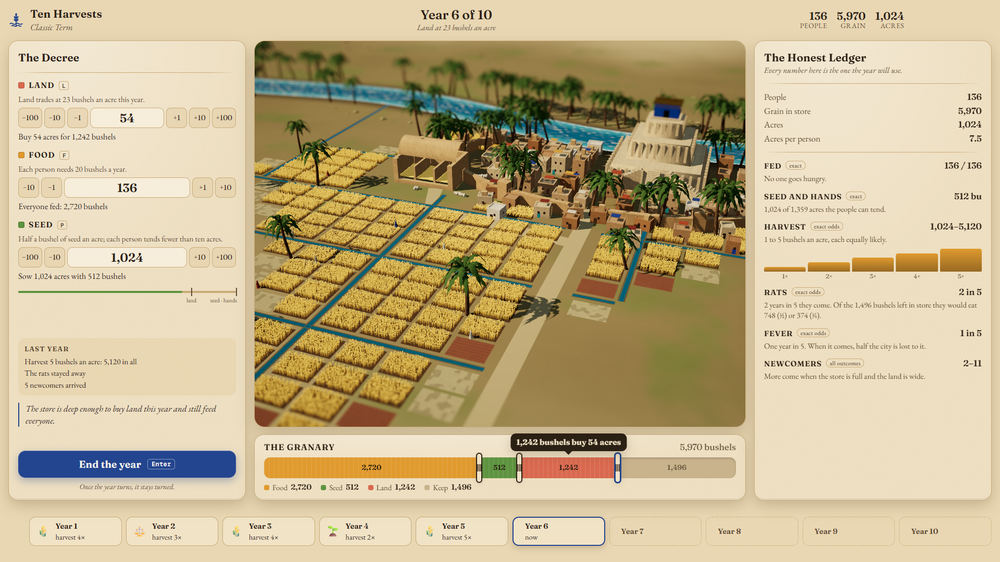
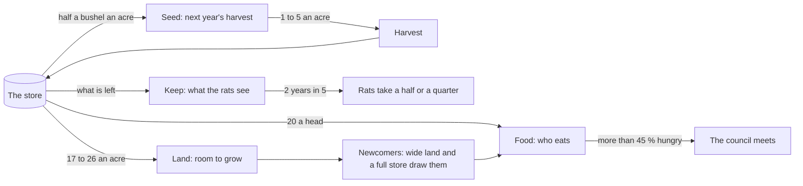

# Ten Harvests

> Ten years. Three numbers. One river.

## The original

Doug Dyment wrote the first version in 1968: a small program in which you rule an ancient city for ten
years. The BASIC version most people know was printed in David H. Ahl's _BASIC Computer Games_ (1978)
under the title _Hamurabi_, and a generation typed it in. It is one of the first simulation games: the
terminal asks you four questions a year and answers with a handful of numbers.

## The hook

Three numbers (people, land, grain) and one store of grain that has to pay for everything. Every bushel
fed today is a bushel not sown for next year, and every acre bought is a winter's bread spent on
somebody's grandchildren. The river decides the harvest and you never know which year it will be
generous. Two details in the old listing make it even more interesting than it looks:

- **The fever is more common than promised.** A comment in the listing says the plague comes 15 % of
  the time. The arithmetic below that comment brings it one year in five, 20 %. Ten Harvests uses the
  arithmetic and tells you so: the ledger says "1 in 5".
- **The generosity paradox.** The end-of-term average of hunger skips any year in which more people
  were fed than lived in the city. A generous year therefore counts the earlier years again, and a
  ruler who feeds exactly enough is judged better than one who is generous. Ten Harvests fixes this in
  the normal game and keeps it, waiting to be found, in the 1978 Ledger.

## What it is like now

The city is a small diorama on the Euphrates, built and lit in three.js: wheat that sways and ripens,
canals, mud-brick houses, a ziggurat, a granary you can see into. It is a chart as much as a picture.
Every parcel is ten acres, the granary fills in proportion to the store, and at night every lit window
is ten of your people.

You write the year's decree on a clay tablet: land, food, seed. The granary bar under the city shows
where the store goes and you can drag between its parts. The Honest Ledger beside it gives every
number the year will use, and for the chances it states the exact odds: five harvests from 1 to 5
bushels an acre, each equally likely; rats two years in five, eating a half or a quarter of what you
keep; fever one year in five. When you end the year you watch it happen: the flood, the sowing, the
green, the gold, the harvest pouring into the granary as a river of grain, the rats, the families
walking in along the river road. Then the scribe's report.

At the end of a term the stonecutters carve your stele, one register per year, in raking light. The
chronicle remembers you by an epithet ("Steady Through the Lean Years"), and the Codex keeps what you
learned about the river.

Both appearances are designed: noon light over the silt and green, and a deep blue night with lamps in
the windows, torches on the walls and lanterns coming up the road.

## At a glance

|             |                                                                                                                 |
| ----------- | --------------------------------------------------------------------------------------------------------------- |
| Players     | 1P                                                                                                              |
| A turn is   | one year                                                                                                        |
| A run lasts | 10 years (Dynasty: 30) · about 10–20 minutes                                                                    |
| Scenarios   | 6 curated starts, each with one twist, plus Dynasty and the 1978 Ledger                                         |
| Daily world | yes: the same city for everyone each day                                                                        |
| Rendering   | three.js (WebGL) for the city and the stele, DOM and SVG for the panels; see [ARCHITECTURE.md](ARCHITECTURE.md) |

## Why play it today

- The original's model is kept exactly, numbers and all, but you can finally see it: what each choice
  costs, what the odds are, and what the year did.
- A term takes a quarter of an hour, and each one ends with a carved stone that says how you ruled.
- The 1978 Ledger brings back the teletype, the four questions and the old quirks, for anyone who
  typed it in the first time.
