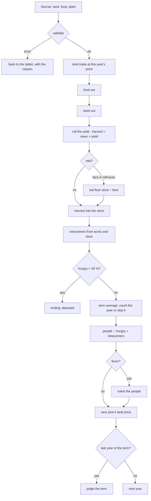
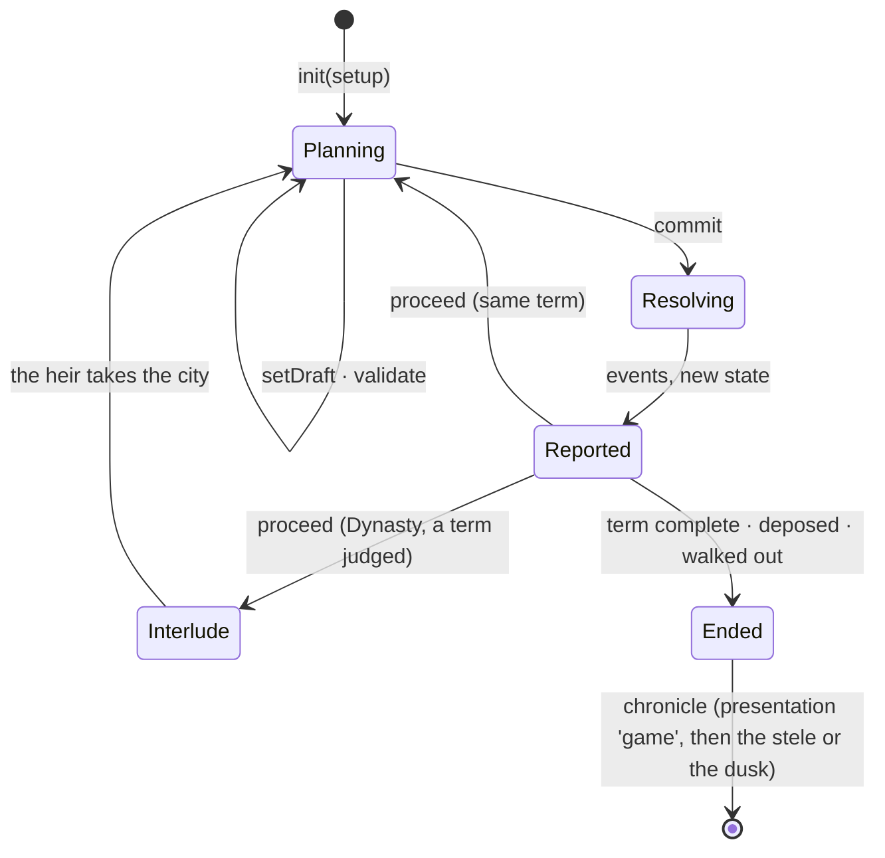
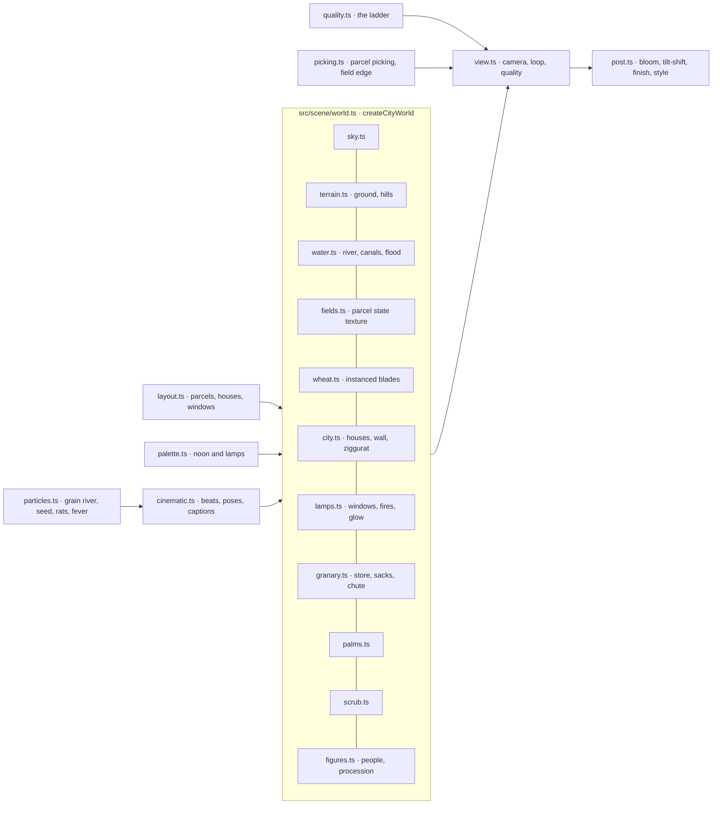

# Ten Harvests — architecture

For programmers. After reading this you should be able to change a formula, add a scenario, retune a
colour or a sound, and know which test will tell you if you broke something.

## Module map

```mermaid
flowchart TD
  manifest[manifest.ts] --> hall[Hall registry]
  index[src/index.ts · SimModule] --> app[src/game/app.ts · screens and flow]
  index --> demo[src/demo.ts · Hall demo]
  app --> engine[src/engine · CityState, Decree, cityModel]
  app --> scene[src/scene · the city in three.js]
  app --> stele[src/stele · the carved stone]
  app --> ui[src/ui · tablet, granary bar, ledger, teletype]
  app --> content[src/content · words, milestones, Codex]
  ui --> engine
  scene --> engine
  engine --> kit[@one-more-year/kit]
  app --> kit
```

| Folder / file  | What it owns                                                                                                                                                                                                                     |
| -------------- | -------------------------------------------------------------------------------------------------------------------------------------------------------------------------------------------------------------------------------- |
| `manifest.ts`  | The SimManifest: title, tagline, signals, scenarios, accents, emblem, status.                                                                                                                                                    |
| `src/engine/`  | The pure model, no DOM and no three.js: rules and scenarios (`rules.ts`), state (`state.ts`), the year (`model.ts`), verdicts (`judge.ts`), the exact ledger (`odds.ts`), bots and seeded simulation (`bots.ts`, `simulate.ts`). |
| `src/scene/`   | The city: layout, materials and shaders, wheat, water, granary, figures, particles, the cinematic, the camera and post-processing, the quality ladder, picking.                                                                  |
| `src/stele/`   | The stele: the relief plan from a term's history, the height map, the three.js scene, the SVG export.                                                                                                                            |
| `src/ui/`      | DOM and SVG panels: the decree tablet and its steppers, the granary bar, the ledger, the year strip, the plan screen, the teletype and the console's question flow.                                                              |
| `src/game/`    | The flow between screens (`app.ts`), the plan controller (map input, keys), options, sounds, and one file per screen in `screens/`.                                                                                              |
| `src/content/` | Every word on screen: event lines, verdict lines, headlines, the scribe's advice, epithets, milestones, the Codex, the short How to play.                                                                                        |
| `dev/`         | Development pages on port 4480: the real Hall with the game playable (`index.html`), the year studio, the stele, the plan and the art studio.                                                                                    |
| `e2e/`         | The Playwright suite (port 5480), screenshot and frame-rate runs, and small scripts used during development.                                                                                                                     |

## The model

All numbers are whole bushels, acres and people. `P` is the people at the start of the year, `A` the
acres after the land trade, `S` the store.

| Quantity      | Formula                                                                                                    | Notes                                                                                         |
| ------------- | ---------------------------------------------------------------------------------------------------------- | --------------------------------------------------------------------------------------------- |
| Land price    | uniform whole number in the scenario's range (17–26)                                                       | Land Fever 10–40; drawn for the coming year                                                   |
| Land trade    | buy `n` acres for `n × price`, or sell for the same                                                        | buy or sell, not both; at least one acre stays                                                |
| Fed           | `floor(food ÷ 20)`                                                                                         | `BUSHELS_PER_PERSON` in `rules.ts`                                                            |
| Seed          | `floor(acres sown ÷ 2)`                                                                                    | `seedFor`; an odd acre is free                                                                |
| Workers limit | `10 × P − 1` acres                                                                                         | `workersLimit`; strictly fewer than ten each                                                  |
| Yield         | uniform 1–5 an acre                                                                                        | Dry Decade 1–3, Generous Delta 3–6                                                            |
| Rats          | die 1–5; on a face in `ratFaces` (2 and 4) they eat `floor(S ÷ face)`                                      | S is the store after land, food and seed, before the harvest; Year of Rats uses faces 2, 3, 4 |
| Newcomers     | `floor(d × (20 × A + S) ÷ P ÷ 100 + 1)`, `d` uniform 1–5                                                   | S after rats and harvest                                                                      |
| Hungry        | `P − fed`, or 0 if `fed > P`                                                                               |                                                                                               |
| Deposed       | hungry `> 0.45 × P`                                                                                        | `DEPOSITION_SHARE`; ends the run that year                                                    |
| Fever         | one year in `feverOneIn` (5), people halved, rounded down                                                  | Generous Delta: one in 3; after hunger and newcomers                                          |
| Term average  | normal: mean of each year's hungry percent; 1978: `((y−1) × avg + pct) ÷ y`, skipping years with `fed > P` | `countsTowardAverage`, `nextLedgerAverage`                                                    |
| Verdict       | bands on (average hunger, acres per head): ≤ 3 % and ≥ 10; ≤ 10 % and ≥ 9; ≤ 33 % and ≥ 7; else the lowest | `TIER_BANDS` in `judge.ts`; Ten Quiet Years needs nobody hungry all term                      |

The two rule sets share one engine. Each difference between them is a named function in `model.ts`,
tested both ways: `countsTowardAverage`, `nextLedgerAverage` and `walksOut`.

One year (`cityModel.resolve`):



The engine's states, as the play session sees them:



## Random streams

Each step gets its own stream from the kit, `rngForStep(seed, step)`, and every kind of chance forks
its own named stream from it. Planting more never changes whether the rats come.

| Stream label             | Draws      | Used for                                    |
| ------------------------ | ---------- | ------------------------------------------- |
| `land-price`             | 1 per year | next year's price (and the opening price)   |
| `yield`                  | 1 per year | bushels an acre                             |
| `rats`                   | 1 per year | the rats' die                               |
| `newcomers`              | 1 per year | the newcomers' die                          |
| `plague`                 | 1 per year | the fever (named after the original's flag) |
| `bot` (simulate.ts only) | per step   | the bots' own choices, apart from the world |

The scene uses fixed seeds of its own (`ten-harvests:layout`, `ten-harvests:rats`, and so on) so the
city looks the same for everyone; they never touch the engine.

## Forecasts

The ledger is computed by `ledgerFor(state, decree)` in `src/engine/odds.ts`, by enumeration rather
than sampling: fed and hungry, seed and hands, the five (or three, or four) harvests and what each brings
in, the rats' odds and the bushels they would take on each face, the fever's odds, the full range of
newcomers and of the store after the year. `tests/determinism.test.ts` checks over 300 seeds that the
year always lands on one of the outcomes the ledger named. The kit's `session.forecast` is not used;
the model is small enough to state exactly.

## Rendering

three.js (r186), see [ADR 0001](adr/0001-three-js-rendering.md). One `WebGLRenderer` is shared by every
screen that shows the city; the stele has its own small scene.



- **The scene is a chart.** `layout.ts` builds a fixed city: 240+ parcels ordered by distance from the
  granary, houses with numbered windows, palms, lanes. `world.show(values)` maps the numbers onto it:
  `parcelsForAcres` (one parcel per ten acres), `windowsForPeople` (one lit window per ten people),
  `figuresForPeople`, and the granary's fill (`fillFor`, linear up to 8,000 bushels at the brim).
- **Fields** are one `DataTexture` with a texel per parcel (ownership, sown, season, yield quality,
  highlight). The ground and wheat shaders read it with `texelFetch`, so a decree changes a few bytes,
  not geometry.
- **Wheat** is an instanced blade with ear; density comes from the quality profile, height and colour
  from season and yield, sway from a shared gust uniform.
- **Water** is one shader in three kinds: river, canal and flood; canals show only beside owned parcels.
- **Light and dark** are two designed palettes (`NOON` and `LAMPS` in `palette.ts`), not a filter:
  sun direction, sky, fog, exposure and bloom change, windows and fires light, lanterns walk the road.
- **The cinematic** (`cinematic.ts`) is a list of beats (flood, seed, grow, harvest, rats, newcomers,
  fever, settle) with a camera pose and a length each. `seek(t)` sets the whole world for any moment,
  so a frame can be frozen, skipped or scrubbed. The grain river is a particle arc from the cut fields
  to a confluence and into the granary's chute.
- **Post-processing** (`post.ts`): render → bloom → tilt-shift (a one-pass disc blur away from the
  focus band) → finish (vignette, grade) → output → style (the Hall's engraving and instrument looks,
  used by the demo).
- **The Hall's drawn styles** (Almanac's engraving, Situation Room's instrument) are sketches, not
  filters over the full picture. The demo switches the world to `setSketch(true)`, which hides the
  wheat, palms, scrub, walkers and lamp glows, draws the city at noon from a closer, higher camera
  (`SKETCH_POSE` in `src/demo.ts`), and the style pass finds edges on a slightly smoothed picture and
  inks only the darker side of each, over a wash of two or three tones. Terrarium keeps the full
  diorama. Line weight is the `smoothstep` on `edge` in `STYLE_FRAGMENT` (`post.ts`).
- **The stele** (`src/stele/`) draws a relief plan to a 1024×2304 height map on a canvas and shades a
  flat slab with it: parallax, a ray-marched shadow toward the light, chisel marks along the carving
  edge, torches at night. The same plan exports as SVG.
- **Reduced motion:** the wind drops and the menu's camera stops circling; the camera cuts between views
  instead of gliding; the cinematic shows its beats as stills with captions; the stele appears already
  carved; the teletype prints a line at a time; panels appear without rising.

### The quality ladder

| Level    | Wheat blades a parcel | Shadows | Bloom | Tilt-shift | MSAA | Resolution |
| -------- | --------------------- | ------- | ----- | ---------- | ---- | ---------- |
| High     | 700                   | 2048    | yes   | yes        | 4×   | 100 %      |
| Balanced | 320                   | 1024    | yes   | no         | 2×   | 100 %      |
| Light    | 130                   | none    | no    | no         | none | 80 %       |

`createQualityLadder` watches frame times (ignoring the 30 frames after any change, while shaders
compile). Two seconds of frames 25 % over the 60 fps budget step down one level; eight seconds well
under it step back up, never above the player's choice in Options. When WebGL runs on the CPU (no GPU,
or a blocked driver; `webglRunsOnCpu` in `src/scene/gpu.ts`) the ladder starts at Light and the
canvas renders at 60 % resolution, and the Hall's demo draws a flat Canvas 2D map of the same city
instead of the diorama (`src/scene/city-map.ts`): plots for the acres, filled houses for the people,
the granary's fill for the store. It compiles nothing, so the Hall's home page never waits on it.

Before the first frame, `post.warm()` compiles every shader with `compileAsync`: the scene as it draws
into the composer's target (those variants differ from drawing to the screen) and the full-screen
passes. Without it the first frame compiled them on the spot and held the page for about a second; with
it the longest main-thread stall while the city starts is about 40 ms (`e2e/build-probe.ts`).

Measured during the cinematic (yield 5, year 3) on an RTX 4060 with the frame-rate cap lifted, median
of eight seconds (runs vary by about 10 %):

| Size      | High    | Balanced | Light    |
| --------- | ------- | -------- | -------- |
| 1280×720  | 582 fps | 917 fps  | 2054 fps |
| 1920×1080 | 352 fps | 514 fps  | 1468 fps |

`SHOTS=1 pnpm --filter @one-more-year/ten-harvests shots` re-measures and writes `fps.json`.

## Where things are defined

| To change                                  | Edit                                                     |
| ------------------------------------------ | -------------------------------------------------------- |
| A rule or a scenario's twist               | `src/engine/rules.ts` (`CLASSIC_START`, `TWEAKS`)        |
| The order of the year or an event          | `src/engine/model.ts` (`resolveYear`)                    |
| Verdict bands and labels                   | `src/engine/judge.ts` (`TIER_BANDS`, `VERDICTS`)         |
| A colour in the city, by appearance        | `src/scene/palette.ts` (`NOON`, `LAMPS`)                 |
| A colour in the panels                     | `src/ui/ten-harvests.css` (tokens under `.th`)           |
| The city's shape: parcels, houses, windows | `src/scene/layout.ts`                                    |
| The length or camera of a cinematic beat   | `src/scene/cinematic.ts` (`LENGTHS`, `POSES`)            |
| The rats, the grain river, the fever haze  | `src/scene/particles.ts`                                 |
| Wheat density and other quality settings   | `src/scene/quality.ts` (`PROFILES`)                      |
| A sound cue or the wind                    | `src/game/sound.ts` (`SOUND`, `PLAIN_WIND`, the recipes) |
| When a cue plays                           | `src/game/screens/turning.ts` (beats), `src/game/app.ts` |
| A report line                              | `src/content/text.ts` (`EVENT_TEXT`, `headlineFor`)      |
| A verdict's two lines                      | `src/content/text.ts` (`VERDICT_LINES`)                  |
| Epithets, milestones, the Codex            | `src/content/legacy.ts`                                  |
| The teletype's questions and refusals      | `src/ui/console-flow.ts`                                 |
| The stele's motifs and layout              | `src/stele/relief.ts`                                    |

## Contract usage

- `mount` builds the game's own screens: game menu, scenarios, plan, the year, report, stele, dusk.
  `app.ts` starts a run with `startPlay(ctx, PLAY_RULES, launch)`; the rules carry the model, event text,
  epithets, the chronicle's title, glyph and share line, the run length and `presentation: 'game'`.
- `ctx.setView` follows the screens ('plan', 'report', 'results'), and `setPauseItems` adds the
  scribe's console (not in the 1978 Ledger, where it is always open), the Codex and the game's options.
- When a run ends the session reports the chronicle with `presentation: 'game'`; the game shows the
  stele (or the dusk, for a deposition or a walk-out), then hands over with
  `ctx.navigate({ results: chronicle.id })` (ADR-0008 in `docs/adr/`).
- Milestones: most are checked by the session at the end of a run (`atRunEnd`) or by Codex count;
  `no-idle-bushel`, `five-harvests` and `scribes-console` are unlocked or advanced by hand in `app.ts`.
- The demo (`src/demo.ts`) uses the kit's `createModelDemo` with the careful bot and the city at light
  quality, restyled for the Hall's engraving and instrument looks.

## Saves

`saves: { version: 1 }`. A run record holds the kit's snapshot of the engine: the setup (seed,
scenario) and the plans so far, from which the state is replayed. The game's options and its best
verdicts live in the simulation's settings namespace. There are no migrations yet.

## Tests

| Test                           | Guards                                                                                                                    |
| ------------------------------ | ------------------------------------------------------------------------------------------------------------------------- |
| `tests/engine.test.ts`         | each rule, both rule sets, scripted dice; validation; endings; Dynasty terms                                              |
| `tests/fidelity.test.ts`       | 10,000 seeded 1978 years against an independent reference written from NOTES.md; the dice's distributions; the 20 % fever |
| `tests/determinism.test.ts`    | replay from seed and plans; the daily world; separate streams; the ledger names every outcome                             |
| `tests/balance.test.ts`        | the bot results in NOTES.md, within tolerances                                                                            |
| `tests/ui.test.ts`             | the granary budget and handles; the console's questions and refusals                                                      |
| `tests/scene.test.ts`          | parcels, windows, figures and granary fill against the numbers; the quality ladder                                        |
| `tests/text.test.ts`           | headlines; counted nouns                                                                                                  |
| `e2e/specs/flows.spec.ts`      | a Classic term by mouse and by keyboard, deposition, the console, resume after reload, replay with a ghost                |
| `e2e/specs/modes.spec.ts`      | today's world in two browsers, a scenario, Dynasty with its interludes, the 1978 Ledger and its averaging quirk           |
| `e2e/specs/navigation.spec.ts` | every way out and back; axe in both appearances; Tab order with visible focus; reduced motion                             |
| `e2e/shots/critique.spec.ts`   | screenshots at two sizes and both appearances, and the frame rates above (SHOTS=1)                                        |

The end-to-end suite runs against the development Hall on port 5480:
`pnpm --filter @one-more-year/ten-harvests e2e`. Seeds with known endings are listed in
`e2e/specs/support.ts` and can be found again with `e2e/seed-search.ts`.

## Adding a scenario

1. Add its `ScenarioSummary` to `manifest.ts` (title, twist, difficulty).
2. Add its changes to `TWEAKS` in `src/engine/rules.ts` and its id to `CURATED_SCENARIOS` if it belongs
   on the Scenarios screen.
3. Add a careful-bot row to `tests/balance.test.ts` (top tier in at least 10 % of seeds) and a line to
   NOTES.md.
